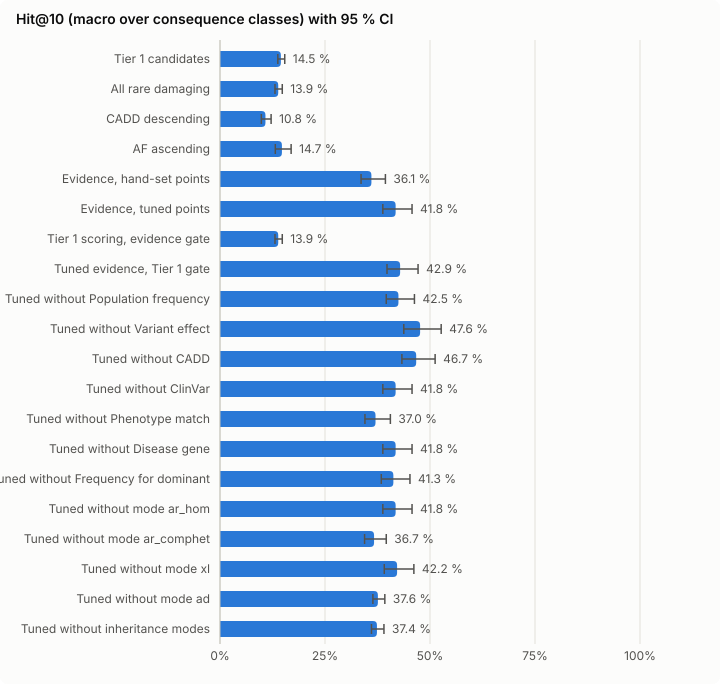
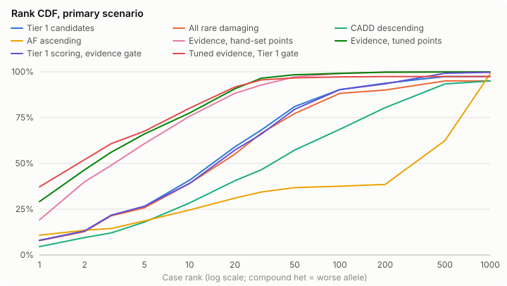

> **Superseded** by [`2026-10-12-full-v2`](../2026-10-12-full-v2/report.md) (template `xl` mode fix and review fixes). The ship decision cites v2.

# Evidence shortlist simulation — 2026-10-12-full

Created 2026-10-12T16:02:02.414Z. Reference scorer `tier1`, candidate `evidence_tuned`. All numbers are aggregates over simulated cases; no background row is reported.

## Ship verdict

**Verdict: DO NOT SHIP** — at least one pre-registered criterion (spec §11.5) fails; no preset is seeded.

| Criterion | Value | Needs | Result |
| --- | --- | --- | --- |
| Test gene clusters (primary) | 1178 | ≥ 300 | pass |
| Mode strata in the pooled endpoint | 4 | ≥ 1 stratum with ≥ 30 cases | pass |
| Primary: lower 95 % bound of ΔHit@10 | 0.2420 | > +0.03 | pass |
| Primary: upper 95 % bound of Δ decoys in top 10 | 0 | ≤ +0.5 | pass |
| ClinVar visible: lower 95 % bound of ΔHit@10 | -0.1902 | > -0.02 | **FAIL** |
| ClinVar visible: upper 95 % bound of Δ decoys in top 10 | -0.0035 | ≤ +0.5 | pass |
| Filter sensitivity: one-sided 97.5 % Clopper–Pearson lower bound (1176/1178 clusters) | 0.9939 | ≥ 0.97 | pass |

Pooled mode strata: AD, AR_HOM, AR_COMPHET, XLD.

- Failed: ClinVar visible: lower 95 % bound of ΔHit@10 = -0.1902 (needs > -0.02)

## Ship verdict — hand-set points (`evidence_hand`, pre-registered)

**Verdict: SHIP** — every pre-registered criterion (spec §11.5) holds; the hand-set preset may be seeded as a non-default beta.

| Criterion | Value | Needs | Result |
| --- | --- | --- | --- |
| Test gene clusters (primary) | 1178 | ≥ 300 | pass |
| Mode strata in the pooled endpoint | 4 | ≥ 1 stratum with ≥ 30 cases | pass |
| Primary: lower 95 % bound of ΔHit@10 | 0.1907 | > +0.03 | pass |
| Primary: upper 95 % bound of Δ decoys in top 10 | 0 | ≤ +0.5 | pass |
| ClinVar visible: lower 95 % bound of ΔHit@10 | 0.0699 | > -0.02 | pass |
| ClinVar visible: upper 95 % bound of Δ decoys in top 10 | -0.0160 | ≤ +0.5 | pass |
| Filter sensitivity: one-sided 97.5 % Clopper–Pearson lower bound (1176/1178 clusters) | 0.9939 | ≥ 0.97 | pass |

Pooled mode strata: AD, AR_HOM, AR_COMPHET, XLD.

Decision: the tuned preset fails and the hand-set preset passes — ship the hand-set points.

## Findings

- **Hand-set points ship** under the pre-registered rule (spec §11.5, §15): primary ΔHit@10 vs Tier 1 = +21.6 [+19.1, +25.0] pts, ClinVar-visible lower bound +7.0 pts, Δ decoys ≤ 0, filter sensitivity 1176/1178 gene clusters (Clopper–Pearson lower bound 0.994).
- **Tuned points do not ship.** They rank better with ClinVar masked (ΔHit@10 +27.3 [+24.2, +31.4] pts), but fail the ClinVar-visible safety check: Hit@10 71.5 % vs Tier 1 86.7 % (Δ −15.2 [−19.0, −10.4] pts). Cause: the unrounded P/LP estimate is about +22 (bootstrap interval of the raw value [+21.2, +22.9]) and is clipped to +8, while the other tuned groups span up to 8 points each (anchors at the best bins, catch-alls at −8). ClinVar P/LP therefore no longer dominates the score, unlike Tier 1's pin and the hand-set +6 against smaller bins. Future work (not applied, spec §15 decides): exempt the ClinVar P/LP estimate from the ±8 clip, or tune ClinVar after the other groups.
- **Phenotype dependence.** Shuffling `hpo_sim_score` across genes costs the tuned scorer 14.5 pts (41.8 → 27.3 %) and the hand-set scorer 1.9 pts (36.1 → 34.2 %); without phenotype (masked) tuned 37.0 %, hand-set 32.6 %. With the spike gene in the case's top HPO decile: hand-set 66.3 %, tuned 58.4 %. The tuned points lean on phenotype much more than the hand-set ones — a ranking with a wrong or uninformative HPO profile degrades accordingly.
- **Missingness is a stress test, harsher than reality.** Spike rows take the joint AF/CADD missingness of a random background row with the same `func`, and the spike gene's gene-level fields (OMIM, MOI, HPO) are dropped with the background's all-gene missingness rate. Most background genes are not disease genes and lack these fields, so disease genes lose them far more often than in real data. Under this stress Hit@10 falls below Tier 1 (hand-set 10.2 %, tuned 8.4 %, Tier 1 14.1 %): without MOI no inheritance mode applies and without OMIM the gene bin turns negative.
- **Missense.** Tier 1 and All rare damaging place no missense case in the top 10 (Hit@10 0.0 %): varvis labels many background rows HIGH (incl. 313 `mnv`), and MODERATE rows lose on the impact component. Evidence scoring reaches 42–53 % on missense.
- **CADD imputation does not drive the result.** SNV-only cases (real CADD for every causal allele): tuned − Tier 1 = +31.9 [+27.1, +36.9] pts. With imputation off (spike indels keep missing CADD): hand-set +21.8 [+19.3, +25.4], tuned +26.1 [+23.2, +29.8] pts. Imputed spike rows: 1,856 of 40,461 (indels).
- **Decoy intrusion** is negligible for every scorer (≤ 0.02 decoys per case in the top 10).
- **Small class.** The inframe class has 6 test cases (0 % Hit@10 for every scorer) yet carries a quarter of the macro weight, which skews bootstrap intervals; see the sensitivity analysis at the end (primary endpoint and ship decision unchanged).

## Run history

A first full run (same protocol) exposed an annotation bug: local VEP's `--flag_pick` chose a transcript of a different, overlapping gene for 299 of 5,427 pool variants, and 197 causal alleles were projected to `upstream/downstream_gene_variant` (MODIFIER) and gated out. Filter sensitivity was then 95.4 % of alleles, 1106/1178 clusters (lower bound 0.924, FAIL for both presets); tuned ΔHit@10 +23.1 [+21.2, +30.7], hand-set +19.3 [+17.7, +25.5] pts. The pool annotation was re-frozen with transcripts restricted to the pool gene (lane C, 299 → 0 wrong-gene picks) and the concordance recomputed; this report is the rerun. Earlier, a smoke run and a quick run (bg1 only) exposed estimator artefacts that led to the §14/§15 amendments (see "Tuned points").

## Data protection

Committed files hold aggregates only: ranks, counts, intervals and points, no coordinates, genes, sample or LIMS labels of the backgrounds. The concordance artefact contains pooled VEP-term × varvis-term counts over the three exomes, some cells below 5; small-cell suppression was not applied because the projection pools rows across mapping levels and suppressing cells would change the simulation inputs. Background rows, normalised background keys and local VEP output stay in the private data directory outside the repository; no background-derived value was sent over the network (the CADD API received pool variants only).

## Threats to validity

Three immunology exomes from one lab, all female (no male X-linked recessive cases); ClinVar ascertainment (macro over classes, temporal stratum); CADD and other predictors carry indirect ClinVar training signal; spike CADD is CADD v1.7 while the varvis CADD version is unknown (concordance on coding SNVs accepted it); indel spike CADD is imputed from background rows; spikes enter through the production mapper and `insertBatch`, not the worker import executor; spike rows get the highest row ids, so on a complete tie (score and every tie-breaker) they sort last.

## Primary endpoint

Primary scenario (ClinVar masked on all rows, pins off), test folds, Hit@k macro-averaged over consequence classes and pooled over AD, AR_HOM, AR_COMPHET, XLD modes. Intervals: 95 % gene-cluster bootstrap. Δ = scorer − reference, paired over the same resampled clusters.

Test gene clusters: 1178.

| Scorer | Cases | Hit@10 [95 % CI] | Hit@1 | Hit@5 | Hit@20 | Hit@50 | Tie-avg Hit@10 | MRR | Tie-avg MRR | Median rank | ΔHit@10 vs reference |
| --- | --- | --- | --- | --- | --- | --- | --- | --- | --- | --- | --- |
| Tier 1 candidates | 3620 | 14.5 % [13.8 %, 15.4 %] | 2.8 % | 9.4 % | 23.5 % | 39.8 % | 14.5 % | 0.073 | 0.071 | 15.0 | reference |
| All rare damaging | 3620 | 13.9 % [13.1 %, 14.8 %] | 2.8 % | 9.1 % | 19.9 % | 36.6 % | 13.9 % | 0.069 | 0.068 | 18.0 | -0.6 [-0.8, -0.5] pts |
| CADD descending | 3620 | 10.8 % [9.8 %, 12.2 %] | 1.6 % | 6.4 % | 17.8 % | 28.9 % | 10.9 % | 0.050 | 0.050 | 36.0 | -3.7 [-4.6, -2.8] pts |
| AF ascending | 3620 | 14.7 % [13.2 %, 16.9 %] | 5.2 % | 9.7 % | 21.5 % | 32.5 % | 1.4 % | 0.083 | 0.010 | 440.0 | +0.3 [-1.4, +2.0] pts |
| Evidence, hand-set points | 3620 | 36.1 % [33.6 %, 39.4 %] | 6.8 % | 24.6 % | 49.1 % | 69.8 % | 36.3 % | 0.169 | 0.174 | 4.0 | +21.6 [+19.1, +25.0] pts |
| Evidence, tuned points | 3620 | 41.8 % [38.8 %, 45.7 %] | 11.0 % | 31.9 % | 56.1 % | 68.4 % | 42.7 % | 0.217 | 0.221 | 3.0 | +27.3 [+24.2, +31.4] pts |
| Tier 1 scoring, evidence gate | 3620 | 13.9 % [13.1 %, 14.8 %] | 2.8 % | 9.4 % | 22.4 % | 38.1 % | 13.9 % | 0.071 | 0.070 | 17.0 | -0.6 [-0.8, -0.5] pts |
| Tuned evidence, Tier 1 gate | 3620 | 42.9 % [39.8 %, 47.2 %] | 14.8 % | 32.2 % | 53.7 % | 60.8 % | 43.5 % | 0.239 | 0.243 | 2.0 | +28.4 [+25.1, +32.8] pts |
| Tuned without Population frequency | 3620 | 42.5 % [39.6 %, 46.3 %] | 10.8 % | 30.9 % | 50.8 % | 61.8 % | 43.9 % | 0.208 | 0.215 | 3.0 | +28.0 [+25.0, +31.8] pts |
| Tuned without Variant effect | 3620 | 47.6 % [43.8 %, 52.7 %] | 21.0 % | 40.3 % | 60.7 % | 73.5 % | 48.0 % | 0.308 | 0.313 | 3.0 | +33.2 [+29.4, +38.0] pts |
| Tuned without CADD | 3620 | 46.7 % [43.3 %, 51.2 %] | 15.7 % | 39.3 % | 52.8 % | 67.9 % | 46.1 % | 0.259 | 0.261 | 3.0 | +32.2 [+28.7, +37.0] pts |
| Tuned without ClinVar | 3620 | 41.8 % [38.8 %, 45.7 %] | 11.0 % | 31.9 % | 56.1 % | 68.4 % | 42.7 % | 0.217 | 0.221 | 3.0 | +27.3 [+24.2, +31.4] pts |
| Tuned without Phenotype match | 3620 | 37.0 % [34.5 %, 40.6 %] | 11.2 % | 26.5 % | 46.3 % | 59.6 % | 37.7 % | 0.196 | 0.200 | 3.0 | +22.5 [+19.8, +26.2] pts |
| Tuned without Disease gene | 3620 | 41.8 % [38.8 %, 45.7 %] | 11.0 % | 31.9 % | 56.1 % | 68.4 % | 42.7 % | 0.217 | 0.221 | 3.0 | +27.3 [+24.2, +31.4] pts |
| Tuned without Frequency for dominant | 3620 | 41.3 % [38.4 %, 45.2 %] | 11.0 % | 30.8 % | 54.2 % | 67.7 % | 41.9 % | 0.213 | 0.217 | 3.0 | +26.8 [+23.8, +30.7] pts |
| Tuned without mode ar_hom | 3620 | 41.8 % [38.8 %, 45.7 %] | 11.0 % | 31.9 % | 56.1 % | 68.4 % | 42.7 % | 0.217 | 0.221 | 3.0 | +27.3 [+24.2, +31.4] pts |
| Tuned without mode ar_comphet | 3620 | 36.7 % [34.4 %, 39.6 %] | 3.7 % | 25.8 % | 50.1 % | 65.2 % | 36.4 % | 0.157 | 0.155 | 3.0 | +22.2 [+19.7, +25.5] pts |
| Tuned without mode xl | 3620 | 42.2 % [39.1 %, 46.2 %] | 11.2 % | 32.2 % | 56.0 % | 68.4 % | 43.0 % | 0.220 | 0.224 | 3.0 | +27.7 [+24.6, +31.7] pts |
| Tuned without mode ad | 3620 | 37.6 % [36.4 %, 39.2 %] | 11.1 % | 27.1 % | 53.2 % | 74.1 % | 37.5 % | 0.208 | 0.206 | 3.0 | +23.1 [+21.9, +24.8] pts |
| Tuned without inheritance modes | 3620 | 37.4 % [36.1 %, 39.0 %] | 3.8 % | 27.7 % | 51.0 % | 74.1 % | 37.0 % | 0.166 | 0.161 | 3.0 | +22.9 [+21.6, +24.6] pts |

## Strata (Hit@10, primary scenario)

### Per mode

Macro over classes within the mode; all modes shown, including strata dropped from the pooled endpoint.

| Stratum | Cases | Tier 1 candidates | All rare damaging | CADD descending | AF ascending | Evidence, hand-set points | Evidence, tuned points | Tier 1 scoring, evidence gate | Tuned evidence, Tier 1 gate | Tuned without Population frequency | Tuned without Variant effect | Tuned without CADD | Tuned without ClinVar | Tuned without Phenotype match | Tuned without Disease gene | Tuned without Frequency for dominant | Tuned without mode ar_hom | Tuned without mode ar_comphet | Tuned without mode xl | Tuned without mode ad | Tuned without inheritance modes |
| --- | --- | --- | --- | --- | --- | --- | --- | --- | --- | --- | --- | --- | --- | --- | --- | --- | --- | --- | --- | --- | --- |
| AD | 1248 | 17.7 % | 17.2 % | 15.6 % | 27.6 % | 30.3 % | 29.9 % | 17.2 % | 33.3 % | 30.6 % | 30.0 % | 26.0 % | 29.9 % | 26.0 % | 29.9 % | 29.6 % | 29.9 % | 24.2 % | 29.9 % | 42.8 % | 40.6 % |
| AR_HOM | 1683 | 21.2 % | 20.4 % | 14.7 % | 8.3 % | 62.3 % | 76.5 % | 20.4 % | 74.7 % | 77.9 % | 87.5 % | 91.7 % | 76.5 % | 72.6 % | 76.5 % | 75.9 % | 76.5 % | 68.4 % | 76.5 % | 56.0 % | 51.0 % |
| AR_COMPHET | 641 | 15.6 % | 13.8 % | 7.9 % | 2.4 % | 46.5 % | 45.9 % | 13.8 % | 51.5 % | 51.8 % | 42.5 % | 52.2 % | 45.9 % | 38.3 % | 45.9 % | 45.5 % | 45.9 % | 72.7 % | 45.9 % | 20.9 % | 46.7 % |
| XLD | 48 | 23.0 % | 23.0 % | 12.6 % | 37.5 % | 51.0 % | 38.5 % | 23.0 % | 44.8 % | 38.9 % | 34.8 % | 39.2 % | 38.5 % | 38.5 % | 38.5 % | 38.5 % | 38.5 % | 30.4 % | 66.7 % | 24.9 % | 41.6 % |

### Per consequence class

Plain mean within the class (spec §11.2 class of a case).

| Stratum | Cases | Tier 1 candidates | All rare damaging | CADD descending | AF ascending | Evidence, hand-set points | Evidence, tuned points | Tier 1 scoring, evidence gate | Tuned evidence, Tier 1 gate | Tuned without Population frequency | Tuned without Variant effect | Tuned without CADD | Tuned without ClinVar | Tuned without Phenotype match | Tuned without Disease gene | Tuned without Frequency for dominant | Tuned without mode ar_hom | Tuned without mode ar_comphet | Tuned without mode xl | Tuned without mode ad | Tuned without inheritance modes |
| --- | --- | --- | --- | --- | --- | --- | --- | --- | --- | --- | --- | --- | --- | --- | --- | --- | --- | --- | --- | --- | --- |
| lof | 2553 | 58.0 % | 55.5 % | 39.2 % | 22.0 % | 90.8 % | 89.0 % | 55.5 % | 90.2 % | 90.9 % | 75.1 % | 95.4 % | 89.0 % | 85.9 % | 89.0 % | 88.7 % | 89.0 % | 91.4 % | 89.1 % | 81.4 % | 86.4 % |
| missense | 979 | 0.0 % | 0.0 % | 2.9 % | 33.3 % | 42.4 % | 52.7 % | 0.0 % | 59.3 % | 53.4 % | 59.3 % | 34.1 % | 52.7 % | 43.9 % | 52.7 % | 52.0 % | 52.7 % | 41.9 % | 53.9 % | 67.7 % | 61.8 % |
| inframe | 6 | 0.0 % | 0.0 % | 0.0 % | 0.0 % | 0.0 % | 0.0 % | 0.0 % | 0.0 % | 0.0 % | 0.0 % | 0.0 % | 0.0 % | 0.0 % | 0.0 % | 0.0 % | 0.0 % | 0.0 % | 0.0 % | 0.0 % | 0.0 % |
| other | 82 | 0.0 % | 0.0 % | 1.2 % | 3.7 % | 11.0 % | 25.6 % | 0.0 % | 22.0 % | 25.6 % | 56.1 % | 57.3 % | 25.6 % | 18.3 % | 25.6 % | 24.4 % | 25.6 % | 13.4 % | 25.6 % | 1.2 % | 1.2 % |

### Per background

Leave-one-background-out is reported separately by the runner.

| Stratum | Cases | Tier 1 candidates | All rare damaging | CADD descending | AF ascending | Evidence, hand-set points | Evidence, tuned points | Tier 1 scoring, evidence gate | Tuned evidence, Tier 1 gate | Tuned without Population frequency | Tuned without Variant effect | Tuned without CADD | Tuned without ClinVar | Tuned without Phenotype match | Tuned without Disease gene | Tuned without Frequency for dominant | Tuned without mode ar_hom | Tuned without mode ar_comphet | Tuned without mode xl | Tuned without mode ad | Tuned without inheritance modes |
| --- | --- | --- | --- | --- | --- | --- | --- | --- | --- | --- | --- | --- | --- | --- | --- | --- | --- | --- | --- | --- | --- |
| bg1 | 1188 | 13.8 % | 13.9 % | 10.3 % | 15.4 % | 41.2 % | 46.0 % | 13.9 % | 45.6 % | 48.0 % | 50.0 % | 45.8 % | 46.0 % | 36.0 % | 46.0 % | 46.0 % | 46.0 % | 44.2 % | 46.3 % | 42.1 % | 42.4 % |
| bg2 | 1272 | 14.6 % | 14.5 % | 11.7 % | 10.8 % | 32.3 % | 35.8 % | 14.5 % | 39.5 % | 36.8 % | 44.0 % | 47.5 % | 35.8 % | 33.3 % | 35.8 % | 34.4 % | 35.8 % | 35.2 % | 36.3 % | 30.4 % | 31.2 % |
| bg3 | 1160 | 15.1 % | 13.1 % | 10.3 % | 18.1 % | 35.0 % | 44.1 % | 13.1 % | 43.8 % | 42.9 % | 49.2 % | 46.9 % | 44.1 % | 41.7 % | 44.1 % | 43.9 % | 44.1 % | 31.4 % | 44.3 % | 40.5 % | 38.8 % |

### Temporal stratum

P/LP absent or not P/LP in ClinVar 2024-01 vs older.

| Stratum | Cases | Tier 1 candidates | All rare damaging | CADD descending | AF ascending | Evidence, hand-set points | Evidence, tuned points | Tier 1 scoring, evidence gate | Tuned evidence, Tier 1 gate | Tuned without Population frequency | Tuned without Variant effect | Tuned without CADD | Tuned without ClinVar | Tuned without Phenotype match | Tuned without Disease gene | Tuned without Frequency for dominant | Tuned without mode ar_hom | Tuned without mode ar_comphet | Tuned without mode xl | Tuned without mode ad | Tuned without inheritance modes |
| --- | --- | --- | --- | --- | --- | --- | --- | --- | --- | --- | --- | --- | --- | --- | --- | --- | --- | --- | --- | --- | --- |
| new since 2024 | 599 | 17.3 % | 16.6 % | 14.7 % | 18.0 % | 50.3 % | 55.8 % | 16.6 % | 57.9 % | 56.6 % | 67.8 % | 70.5 % | 55.8 % | 48.1 % | 55.8 % | 55.4 % | 55.8 % | 52.5 % | 56.0 % | 45.6 % | 46.0 % |
| older | 3021 | 14.8 % | 14.2 % | 10.8 % | 14.8 % | 35.9 % | 41.8 % | 14.2 % | 42.8 % | 42.5 % | 47.0 % | 45.8 % | 41.8 % | 37.3 % | 41.8 % | 41.3 % | 41.8 % | 36.3 % | 42.2 % | 38.2 % | 37.8 % |

## Scenarios (Hit@10, macro)

| Scenario | Cases | Tier 1 candidates | All rare damaging | CADD descending | AF ascending | Evidence, hand-set points | Evidence, tuned points | Tier 1 scoring, evidence gate | Tuned evidence, Tier 1 gate | Tuned without Population frequency | Tuned without Variant effect | Tuned without CADD | Tuned without ClinVar | Tuned without Phenotype match | Tuned without Disease gene | Tuned without Frequency for dominant | Tuned without mode ar_hom | Tuned without mode ar_comphet | Tuned without mode xl | Tuned without mode ad | Tuned without inheritance modes | Δ candidate − reference |
| --- | --- | --- | --- | --- | --- | --- | --- | --- | --- | --- | --- | --- | --- | --- | --- | --- | --- | --- | --- | --- | --- | --- |
| primary | 3620 | 14.5 % | 13.9 % | 10.8 % | 14.7 % | 36.1 % | 41.8 % | 13.9 % | 42.9 % | 42.5 % | 47.6 % | 46.7 % | 41.8 % | 37.0 % | 41.8 % | 41.3 % | 41.8 % | 36.7 % | 42.2 % | 37.6 % | 37.4 % | +27.3 [+24.2, +31.4] pts |
| clinvar_visible | 3620 | 86.7 % | 13.9 % | 10.8 % | 14.7 % | 97.4 % | 71.5 % | 99.4 % | 61.1 % | – | – | – | – | – | – | – | – | – | – | – | – | -15.2 [-19.0, -10.4] pts |
| pheno_free | 3620 | 14.5 % | 13.9 % | 10.8 % | 14.7 % | 32.6 % | 37.0 % | 13.9 % | 35.6 % | – | – | – | – | – | – | – | – | – | – | – | – | +22.5 [+19.8, +26.2] pts |
| pheno_shuffled | 3620 | 14.5 % | 13.9 % | 10.8 % | 14.7 % | 34.2 % | 27.3 % | 13.9 % | 28.5 % | – | – | – | – | – | – | – | – | – | – | – | – | +12.8 [+10.3, +16.0] pts |
| missingness | 3620 | 14.1 % | 13.5 % | 10.7 % | 15.3 % | 10.2 % | 8.4 % | 13.5 % | 8.5 % | – | – | – | – | – | – | – | – | – | – | – | – | -5.7 [-6.8, -4.7] pts |
| pheno_enriched | 1204 | 19.2 % | 18.3 % | 13.1 % | 19.5 % | 66.3 % | 58.4 % | 18.3 % | 57.5 % | – | – | – | – | – | – | – | – | – | – | – | – | +39.2 [+31.3, +47.8] pts |

## Decoy intrusion

10 rare benign decoys per case; primary scenario.

| Scorer | Mean decoys in top 10 | Cases with ≥ 1 | Δ mean vs reference [95 % CI] |
| --- | --- | --- | --- |
| Tier 1 candidates | 0.02 | 2.0 % | reference |
| All rare damaging | 0.02 | 2.0 % | 0.00 [0.00, 0.00] |
| CADD descending | 0.02 | 2.3 % | +0.00 [+0.00, +0.00] |
| AF ascending | 0.00 | 0.0 % | -0.02 [-0.03, -0.02] |
| Evidence, hand-set points | 0.02 | 2.0 % | 0.00 [0.00, 0.00] |
| Evidence, tuned points | 0.02 | 2.0 % | 0.00 [0.00, 0.00] |
| Tier 1 scoring, evidence gate | 0.02 | 2.0 % | 0.00 [0.00, 0.00] |
| Tuned evidence, Tier 1 gate | 0.02 | 2.0 % | 0.00 [0.00, 0.00] |
| Tuned without Population frequency | 0.02 | 2.0 % | 0.00 [0.00, 0.00] |
| Tuned without Variant effect | 0.02 | 2.3 % | +0.00 [+0.00, +0.01] |
| Tuned without CADD | 0.04 | 4.4 % | +0.02 [+0.02, +0.03] |
| Tuned without ClinVar | 0.02 | 2.0 % | 0.00 [0.00, 0.00] |
| Tuned without Phenotype match | 0.02 | 2.0 % | 0.00 [0.00, 0.00] |
| Tuned without Disease gene | 0.02 | 2.0 % | 0.00 [0.00, 0.00] |
| Tuned without Frequency for dominant | 0.02 | 2.0 % | 0.00 [0.00, 0.00] |
| Tuned without mode ar_hom | 0.02 | 2.0 % | 0.00 [0.00, 0.00] |
| Tuned without mode ar_comphet | 0.04 | 3.6 % | +0.02 [+0.01, +0.02] |
| Tuned without mode xl | 0.02 | 2.0 % | 0.00 [0.00, 0.00] |
| Tuned without mode ad | 0.05 | 4.5 % | +0.02 [+0.02, +0.03] |
| Tuned without inheritance modes | 0.03 | 2.5 % | +0.00 [+0.00, +0.01] |

## Filter sensitivity and burden

Allele sensitivity = causal alleles passing the scorer’s gate. Cluster bound: one-sided 97.5 % Clopper–Pearson lower bound, failure = gene cluster with ≥ 1 gated-out causal allele. Burden = median eligible rows per case.

| Scorer | Allele sensitivity | Clusters passing | Cluster lower bound | Median burden |
| --- | --- | --- | --- | --- |
| Tier 1 candidates | 97.8 % | 1134/1178 | 95.0 % | 405 |
| All rare damaging | 95.8 % | 1058/1178 | 87.9 % | 440 |
| CADD descending | 100.0 % | 1176/1178 | 99.4 % | 1947 |
| AF ascending | 100.0 % | 1176/1178 | 99.4 % | 1947 |
| Evidence, hand-set points | 100.0 % | 1176/1178 | 99.4 % | 1947 |
| Evidence, tuned points | 100.0 % | 1176/1178 | 99.4 % | 1947 |
| Tier 1 scoring, evidence gate | 100.0 % | 1176/1178 | 99.4 % | 1947 |
| Tuned evidence, Tier 1 gate | 97.8 % | 1134/1178 | 95.0 % | 405 |
| Tuned without Population frequency | 100.0 % | 1176/1178 | 99.4 % | 1947 |
| Tuned without Variant effect | 100.0 % | 1176/1178 | 99.4 % | 1947 |
| Tuned without CADD | 100.0 % | 1176/1178 | 99.4 % | 1947 |
| Tuned without ClinVar | 100.0 % | 1176/1178 | 99.4 % | 1947 |
| Tuned without Phenotype match | 100.0 % | 1176/1178 | 99.4 % | 1947 |
| Tuned without Disease gene | 100.0 % | 1176/1178 | 99.4 % | 1947 |
| Tuned without Frequency for dominant | 100.0 % | 1176/1178 | 99.4 % | 1947 |
| Tuned without mode ar_hom | 100.0 % | 1176/1178 | 99.4 % | 1947 |
| Tuned without mode ar_comphet | 100.0 % | 1176/1178 | 99.4 % | 1947 |
| Tuned without mode xl | 100.0 % | 1176/1178 | 99.4 % | 1947 |
| Tuned without mode ad | 100.0 % | 1176/1178 | 99.4 % | 1947 |
| Tuned without inheritance modes | 100.0 % | 1176/1178 | 99.4 % | 1947 |

## Tuned points (refit on all folds)

Spec §14–15 (amend §11.1): points = log2 enrichment (pseudo-count ½) relative to the group’s anchor — the bin with the most training positives (0 points) — rounded to 0.5, clipped ±8; a group is a complete partition, so the anchor choice does not change any ranking. A bin with a + b < 10 gets 0; a bin with fewer than 5 positives can only score at or below the anchor; a group with fewer than 20 training positives gets 0 throughout. ClinVar is tuned only as P/LP vs the pooled other ClinVar bins (spikes are all P/LP, so the other bins are not identifiable); those keep their template points as non-tuned priors. Positives A = 4259, background rows B = 5692 (primary scenario). Intervals: 95 % gene-cluster bootstrap of the unrounded points, relative to the same anchor.

Protocol note: §14 (anchor) and §15 (most-positive anchor, no bonus for bins with < 5 positives, ClinVar priors) amended the §11.1 estimator after a smoke run (bg1, provisional mapping) and the quick run (bg1, 50 cases) exposed estimator artefacts — all-zero groups under the reference-bin support rule, then positive points for bins without positives. The amendments target the estimator, not observed performance; `evidence_hand` (fully pre-registered points) is reported next to `evidence_tuned` as the pre-registered comparator, and the ship rule is evaluated for both.

| Group | Bin | a | b | Points | Bootstrap interval |
| --- | --- | --- | --- | --- | --- |
| modes | ar_hom (anchor) | 1677 | 16 | 0.0 | [0.00, 0.00] |
| modes | ar_comphet | 1406 | 273 | -4.5 | [-5.70, -3.34] |
| modes | xl | 48 | 13 | -5.0 | [-6.50, -3.41] |
| modes | ad | 1112 | 732 | -6.0 | [-7.46, -5.16] |
| modes | fallback (catch-all) | 16 | 4658 | -8.0 | [-16.81, -13.60] |
| freq | af_missing (anchor) | 1508 | 1126 | 0.0 | [0.00, 0.00] |
| freq | af_lt_1e5 | 993 | 294 | +1.5 | [+1.01, +1.65] |
| freq | af_lt_1e4 | 1329 | 508 | +1.0 | [+0.68, +1.26] |
| freq | af_lt_1e3 | 390 | 993 | -2.0 | [-2.15, -1.40] |
| freq | af_ref (catch-all) | 39 | 2771 | -6.5 | [-7.42, -5.93] |
| effect | lof (anchor) | 2968 | 144 | 0.0 | [0.00, 0.00] |
| effect | missense | 1161 | 1240 | -4.5 | [-4.79, -4.14] |
| effect | inframe | 6 | 138 | -8.0 | [-11.07, -7.63] |
| effect | splice_region | 60 | 227 | -6.5 | [-7.23, -5.52] |
| effect | mnv | 12 | 313 | -8.0 | [-13.67, -7.68] |
| effect | effect_ref (catch-all) | 52 | 3630 | -8.0 | [-11.32, -9.83] |
| cadd | cadd_30 (anchor) | 2248 | 92 | 0.0 | [0.00, 0.00] |
| cadd | cadd_25 | 828 | 205 | -2.5 | [-3.03, -2.17] |
| cadd | cadd_20 | 692 | 481 | -4.0 | [-4.49, -3.69] |
| cadd | cadd_15 | 192 | 482 | -6.0 | [-6.41, -5.49] |
| cadd | cadd_ref (catch-all) | 299 | 4432 | -8.0 | [-8.92, -8.08] |
| clinvar | clinvar_plp | 4259 | 12 | +8.0 | [+21.18, +22.87] |
| clinvar | clinvar_conflict | 0 | 180 | +1.0 (prior, not tuned) | – |
| clinvar | clinvar_vus | 0 | 337 | +1.0 (prior, not tuned) | – |
| clinvar | clinvar_blb | 0 | 823 | -4.0 (prior, not tuned) | – |
| clinvar | clinvar_ref (catch-all) | 0 | 4340 | 0.0 (prior, not tuned) | – |
| phenotype | hpo_15 | 427 | 228 | 0.0 | [-0.67, +0.16] |
| phenotype | hpo_10 | 909 | 352 | 0.0 | [-0.07, +0.51] |
| phenotype | hpo_05 | 1139 | 491 | 0.0 | [-0.21, +0.33] |
| phenotype | hpo_gt0 (anchor) | 1775 | 799 | 0.0 | [0.00, 0.00] |
| phenotype | hpo_ref (catch-all) | 9 | 3822 | -8.0 | [-11.50, -8.90] |
| gene | omim_gene (anchor) | 4259 | 4902 | 0.0 | [0.00, 0.00] |
| gene | gene_ref (catch-all) | 0 | 790 | -8.0 | [-10.62, -10.21] |
| ad_freq | ad_af_high | 0 | 507 | -8.0 | [-12.62, -11.98] |
| ad_freq | ad_af_ref (catch-all) (anchor) | 1112 | 225 | 0.0 | [0.00, 0.00] |

## Ablations

ΔHit@10 = ablation − tuned evidence scorer, primary scenario, paired gene-cluster bootstrap.

| Ablation | ΔHit@10 [95 % CI] |
| --- | --- |
| Tuned without Population frequency | +0.7 [-0.8, +2.3] pts |
| Tuned without Variant effect | +5.8 [+3.0, +9.1] pts |
| Tuned without CADD | +4.9 [+1.9, +8.3] pts |
| Tuned without ClinVar | 0.0 [0.0, 0.0] pts |
| Tuned without Phenotype match | -4.8 [-6.6, -3.5] pts |
| Tuned without Disease gene | 0.0 [0.0, 0.0] pts |
| Tuned without Frequency for dominant | -0.5 [-1.2, -0.1] pts |
| Tuned without mode ar_hom | 0.0 [0.0, 0.0] pts |
| Tuned without mode ar_comphet | -5.1 [-7.4, -3.3] pts |
| Tuned without mode xl | +0.3 [+0.1, +0.6] pts |
| Tuned without mode ad | -4.2 [-7.6, -0.9] pts |
| Tuned without inheritance modes | -4.5 [-7.9, -1.2] pts |

## Pool selection funnel

| Step | Remaining |
| --- | --- |
| pool: records | 4428918 |
| pool: benign_clnsig | 1360242 |
| pool: benign_drop_review | 1073211 |
| pool: benign_eligible | 253937 |
| pool: plp_clnsig | 338445 |
| pool: plp_drop_review | 244142 |
| pool: benign_drop_gene | 30583 |
| pool: plp_eligible | 57553 |
| pool: plp_drop_size | 3423 |
| pool: plp_drop_gene | 10147 |
| pool: benign_drop_size | 2253 |
| pool: plp_drop_disease | 1884 |
| pool: plp_drop_moi_ambiguous | 9931 |
| pool: plp_drop_origin | 1470 |
| pool: plp_drop_moi_none | 9895 |
| pool: benign_drop_origin | 258 |
| pool: plp_eligible_genes | 2620 |
| pool: benign_eligible_genes | 8916 |
| pool: plp_after_gene_cap | 6405 |
| pool: plp_sampled_AD | 1300 |
| pool: plp_sampled_AR | 1800 |
| pool: plp_sampled_XLD | 91 |
| pool: plp_sampled_XLR | 236 |
| pool: benign_after_gene_cap | 15826 |
| pool: benign_sampled | 2000 |
| pool: plp_sampled_new_since_2024 | 509 |
| cases: causal_in_background_genes | 3142 |
| cases: causal_freq_implausible | 26 |
| cases: causal_xlr_not_simulated | 137 |
| cases: cases_AD | 1248 |
| cases: cases_AR_HOM | 1683 |
| cases: cases_AR_COMPHET | 641 |
| cases: cases_XLD | 48 |

## Annotation concordance (spec §11.4)

| Field | Metric | Value | Tolerance | Decision |
| --- | --- | --- | --- | --- |
| gnomad_af (exome_popmax), backgrounds | median |Δlog10| | 0.023 | ≤ 0.1 | accepted |
| gnomad_af (exome_popmax), pool | median |Δlog10| | 0.000 | ≤ 0.1 | accepted |
| cadd, backgrounds | median |Δ| | 0.000 | ≤ 0.5 | accepted |
| cadd, backgrounds | Pearson | 1.000 | ≥ 0.98 | accepted |
| cadd, pool | median |Δ| | 0.000 | ≤ 0.5 | accepted |
| cadd, pool | Pearson | 1.000 | ≥ 0.98 | accepted |

Pool excluded for an unmapped `func` term: 0.1 %.

## Provenance

Bootstrap replicates: 2000.

| Seed | Value |
| --- | --- |
| cases | 20261012 |
| folds | 20261013 |
| bootstrap | 20261014 |
| scenario | 20261015 |
| quick | 20261016 |

| Input | SHA-256 |
| --- | --- |
| pool | `7c837f71fb90ae222088b14406c24d4d54575f82ef5f4a581f264b5e3f21b85e` |
| annotations | `27b74823b69b385c028ca8c638e7d75b0c46e89dbf42f8aedc802535c930cd27` |
| concordance | `9da45fdaa41105e9b0b81ba37dbe885372dcd2e44cbb9fa769905ec18ef0d1dc` |
| caddApiValues | `36b86b9ec66a2b85006df84e20e986aacabf3d429ae0e00cf2e91271a91a8924` |
| template | `7a92289d0e4bd421ab556158d2ba11aac7e2716322e6429ff513f1e5192bd8f9` |
| background:bg1 | `d13ef4a8c0115613f8fbb1ae4ca79178d6bc9f366060bf552396a26c2c4eb4a4` |
| background:bg2 | `afdd197f77286b8b7f45743f8014385b5a10620beb865b11c4a5854e142d716b` |
| background:bg3 | `521c6b22688090313874481307ef5d36bad7a69aa2efe7f60cc00045c93871b5` |

## Sensitivity: macro over classes with ≥ 30 test cases

The pre-registered primary endpoint averages over all consequence classes; a class with very few cases then carries the same weight as a large one, and its absence from a bootstrap resample shifts the macro (skewed intervals). Here classes with fewer than 30 test cases are dropped, as mode strata are. Kept: other, lof, missense; dropped: inframe (6). The ship decision uses the primary endpoint, not this one.

| Scorer | Cases | Hit@10 [95 % CI] | ΔHit@10 vs tier1 |
| --- | --- | --- | --- |
| tier1 | 3614 | 19.3 % [18.3 %, 20.3 %] | reference |
| all_rare_damaging | 3614 | 18.5 % [17.4 %, 19.5 %] | -0.8 [-1.1, -0.6] pts |
| cadd_desc | 3614 | 14.4 % [13.2 %, 16.0 %] | -4.9 [-5.9, -3.6] pts |
| af_asc | 3614 | 19.7 % [17.5 %, 22.0 %] | +0.3 [-2.0, +2.6] pts |
| evidence_hand | 3614 | 48.1 % [45.0 %, 51.4 %] | +28.7 [+25.6, +32.0] pts |
| evidence_tuned | 3614 | 55.8 % [51.7 %, 60.3 %] | +36.4 [+32.4, +41.0] pts |

## Sensitivity: CADD imputation off

Run `2026-10-12-full-caddoff`: identical protocol, but spike indels (and SNVs without a CADD API score) keep a missing CADD instead of a value imputed from the background. Primary scenario, all classes:

| Scorer | Cases | Hit@10 [95 % CI] | ΔHit@10 vs tier1 |
| --- | --- | --- | --- |
| tier1 | 3620 | 12.9 % [12.1 %, 14.0 %] | reference |
| all_rare_damaging | 3620 | 12.5 % [11.7 %, 13.6 %] | -0.4 [-0.5, -0.2] pts |
| cadd_desc | 3620 | 10.5 % [9.6 %, 11.9 %] | -2.4 [-3.2, -1.5] pts |
| af_asc | 3620 | 14.0 % [12.5 %, 16.3 %] | +1.2 [-0.5, +2.9] pts |
| evidence_hand | 3620 | 34.7 % [32.2 %, 38.1 %] | +21.8 [+19.3, +25.4] pts |
| evidence_tuned | 3620 | 39.0 % [36.3 %, 42.7 %] | +26.1 [+23.2, +29.8] pts |

## CADD fidelity check

Spike CADD: SNVs from the CADD v1.7 API; indels (and SNVs without a precomputed score) imputed from background rows with the same varvis func and allele class, missing values included. Spike rows by CADD source: cadd-api 38603, local-vep 0, imputed 1856, none 2. Threat: imputed CADD is not the variant’s own score, and the varvis CADD version is unknown (see the concordance checks).

Primary scenario, SNV-only cases (every causal allele has its real CADD), all modes:

| Scorer | Cases | Hit@10 [95 % CI] |
| --- | --- | --- |
| tier1 | 2601 | 28.2 % [27.3 %, 29.0 %] |
| cadd_desc | 2601 | 22.2 % [20.6 %, 24.0 %] |
| evidence_tuned | 2601 | 60.1 % [55.5 %, 65.0 %] |

ΔHit@10 evidence_tuned − tier1 on SNV-only cases: +31.9 [+27.1, +36.9] pts.
