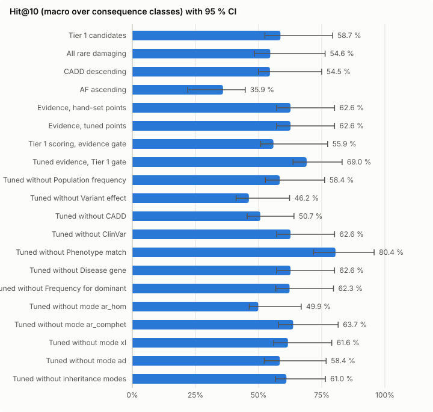
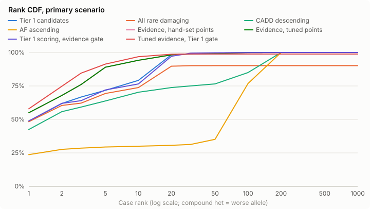

# Evidence shortlist simulation — 2026-10-15-frozen-validation

Created 2026-10-15T17:32:46.892Z. Reference scorer `tier1`, candidate `evidence_tuned`. All numbers are aggregates over simulated cases; no background row is reported.

## Ship verdict

**Verdict: DO NOT SHIP** — at least one pre-registered criterion (spec §11.5) fails; no preset is seeded.

| Criterion | Value | Needs | Result |
| --- | --- | --- | --- |
| Test gene clusters (primary) | 431 | ≥ 300 | pass |
| Mode strata in the pooled endpoint | 5 | ≥ 1 stratum with ≥ 30 cases | pass |
| Primary: lower 95 % bound of ΔHit@10 | -0.0336 | > +0.03 | **FAIL** |
| Primary: upper 95 % bound of Δ decoys in top 10 | 0.0020 | ≤ +0.5 | pass |
| ClinVar visible: lower 95 % bound of ΔHit@10 | 0.0347 | > -0.02 | pass |
| ClinVar visible: upper 95 % bound of Δ decoys in top 10 | -0.1840 | ≤ +0.5 | pass |
| Annotation acceptance fully evaluated (inputs not provisional) | 1 | = 1 | pass |
| Filter sensitivity: one-sided 97.5 % Clopper–Pearson lower bound (431/431 clusters) | 0.9915 | ≥ 0.97 | pass |

Pooled mode strata: AD, AR_HOM, AR_COMPHET, XLD, XLR.

- Failed: Primary: lower 95 % bound of ΔHit@10 = -0.0336 (needs > +0.03)

## Ship verdict — hand-set points (`evidence_hand`, pre-registered)

**Verdict: DO NOT SHIP** — at least one pre-registered criterion (spec §11.5) fails; no preset is seeded.

| Criterion | Value | Needs | Result |
| --- | --- | --- | --- |
| Test gene clusters (primary) | 431 | ≥ 300 | pass |
| Mode strata in the pooled endpoint | 5 | ≥ 1 stratum with ≥ 30 cases | pass |
| Primary: lower 95 % bound of ΔHit@10 | -0.0336 | > +0.03 | **FAIL** |
| Primary: upper 95 % bound of Δ decoys in top 10 | 0.0020 | ≤ +0.5 | pass |
| ClinVar visible: lower 95 % bound of ΔHit@10 | 0.0347 | > -0.02 | pass |
| ClinVar visible: upper 95 % bound of Δ decoys in top 10 | -0.1840 | ≤ +0.5 | pass |
| Annotation acceptance fully evaluated (inputs not provisional) | 1 | = 1 | pass |
| Filter sensitivity: one-sided 97.5 % Clopper–Pearson lower bound (431/431 clusters) | 0.9915 | ≥ 0.97 | pass |

Pooled mode strata: AD, AR_HOM, AR_COMPHET, XLD, XLR.

- Failed: Primary: lower 95 % bound of ΔHit@10 = -0.0336 (needs > +0.03)

Decision: neither preset passes — nothing is seeded.

## Primary endpoint

Primary scenario (ClinVar masked on all rows, pins off), test folds, Hit@k macro-averaged over consequence classes and pooled over AD, AR_HOM, AR_COMPHET, XLD, XLR modes. Intervals: 95 % gene-cluster bootstrap. Δ = scorer − reference, paired over the same resampled clusters.

Test gene clusters: 431.

| Scorer | Cases | Hit@10 [95 % CI] | Hit@1 | Hit@5 | Hit@20 | Hit@50 | Tie-avg Hit@10 | MRR | Tie-avg MRR | Median rank | ΔHit@10 vs reference |
| --- | --- | --- | --- | --- | --- | --- | --- | --- | --- | --- | --- |
| Tier 1 candidates | 4323 | 58.7 % [52.5 %, 79.3 %] | 31.6 % | 49.1 % | 77.5 % | 90.8 % | 58.8 % | 0.412 | 0.411 | 2.0 | reference |
| All rare damaging | 4323 | 54.6 % [48.3 %, 76.3 %] | 30.8 % | 47.6 % | 68.0 % | 79.1 % | 55.9 % | 0.389 | 0.393 | 2.0 | -4.0 [-9.0, -1.0] pts |
| CADD descending | 4323 | 54.5 % [50.0 %, 75.0 %] | 28.0 % | 46.4 % | 62.0 % | 84.3 % | 54.3 % | 0.380 | 0.377 | 2.0 | -4.1 [-12.0, +3.4] pts |
| AF ascending | 4323 | 35.9 % [22.0 %, 44.7 %] | 18.3 % | 26.6 % | 37.9 % | 45.9 % | 5.4 % | 0.237 | 0.032 | 90.0 | -22.7 [-46.6, -11.0] pts |
| Evidence, hand-set points | 4323 | 62.6 % [57.2 %, 80.1 %] | 25.4 % | 52.4 % | 72.7 % | 92.7 % | 59.0 % | 0.373 | 0.342 | 1.0 | +4.0 [-3.4, +11.5] pts |
| Evidence, tuned points | 4323 | 62.6 % [57.2 %, 80.1 %] | 25.4 % | 52.4 % | 72.7 % | 92.7 % | 59.0 % | 0.373 | 0.342 | 1.0 | +4.0 [-3.4, +11.5] pts |
| Tier 1 scoring, evidence gate | 4323 | 55.9 % [50.9 %, 77.3 %] | 32.4 % | 50.2 % | 81.4 % | 97.7 % | 56.0 % | 0.418 | 0.416 | 2.0 | -2.8 [-7.6, +0.8] pts |
| Tuned evidence, Tier 1 gate | 4323 | 69.0 % [63.6 %, 83.1 %] | 27.6 % | 56.2 % | 87.2 % | 90.8 % | 67.6 % | 0.413 | 0.385 | 1.0 | +10.4 [+2.7, +13.0] pts |
| Tuned without Population frequency | 4323 | 58.4 % [52.7 %, 76.1 %] | 22.4 % | 49.4 % | 69.0 % | 91.6 % | 55.4 % | 0.340 | 0.314 | 1.0 | -0.3 [-7.0, +7.5] pts |
| Tuned without Variant effect | 4323 | 46.2 % [41.1 %, 62.3 %] | 24.8 % | 40.8 % | 55.9 % | 75.4 % | 41.4 % | 0.335 | 0.282 | 2.0 | -12.5 [-21.7, -4.9] pts |
| Tuned without CADD | 4323 | 50.7 % [45.5 %, 64.0 %] | 12.6 % | 40.3 % | 68.5 % | 91.4 % | 43.3 % | 0.255 | 0.218 | 2.0 | -8.0 [-17.9, -0.6] pts |
| Tuned without ClinVar | 4323 | 62.6 % [57.2 %, 80.1 %] | 25.4 % | 52.4 % | 72.7 % | 92.7 % | 59.0 % | 0.373 | 0.342 | 1.0 | +4.0 [-3.4, +11.5] pts |
| Tuned without Phenotype match | 4323 | 80.4 % [71.8 %, 95.7 %] | 22.4 % | 61.7 % | 96.4 % | 99.3 % | 76.2 % | 0.398 | 0.376 | 1.0 | +21.8 [+10.9, +32.7] pts |
| Tuned without Disease gene | 4323 | 62.6 % [57.2 %, 80.1 %] | 25.4 % | 52.4 % | 72.7 % | 92.7 % | 59.0 % | 0.373 | 0.342 | 1.0 | +4.0 [-3.4, +11.5] pts |
| Tuned without Frequency for dominant | 4323 | 62.3 % [56.8 %, 79.6 %] | 21.2 % | 50.3 % | 72.6 % | 92.4 % | 58.2 % | 0.342 | 0.319 | 2.0 | +3.6 [-3.8, +11.1] pts |
| Tuned without mode ar_hom | 4323 | 49.9 % [46.3 %, 66.9 %] | 14.4 % | 41.7 % | 69.1 % | 87.9 % | 49.6 % | 0.279 | 0.254 | 2.0 | -8.8 [-18.1, -1.8] pts |
| Tuned without mode ar_comphet | 4323 | 63.7 % [57.9 %, 81.5 %] | 30.1 % | 54.4 % | 78.0 % | 98.8 % | 59.6 % | 0.407 | 0.377 | 1.0 | +5.0 [-1.7, +12.2] pts |
| Tuned without mode xl | 4323 | 61.6 % [56.0 %, 79.0 %] | 25.0 % | 51.7 % | 74.4 % | 92.7 % | 58.3 % | 0.373 | 0.342 | 1.0 | +3.0 [-4.8, +10.5] pts |
| Tuned without mode ad | 4323 | 58.4 % [52.2 %, 76.7 %] | 23.9 % | 49.7 % | 69.5 % | 93.4 % | 55.1 % | 0.355 | 0.322 | 1.0 | -0.3 [-7.4, +8.1] pts |
| Tuned without inheritance modes | 4323 | 61.0 % [56.7 %, 76.5 %] | 21.4 % | 45.3 % | 76.0 % | 86.9 % | 58.7 % | 0.329 | 0.310 | 2.0 | +2.4 [-8.4, +10.2] pts |

## Strata (Hit@10, primary scenario)

### Per mode

Macro over classes within the mode; all modes shown, including strata dropped from the pooled endpoint.

| Stratum | Cases | Tier 1 candidates | All rare damaging | CADD descending | AF ascending | Evidence, hand-set points | Evidence, tuned points | Tier 1 scoring, evidence gate | Tuned evidence, Tier 1 gate | Tuned without Population frequency | Tuned without Variant effect | Tuned without CADD | Tuned without ClinVar | Tuned without Phenotype match | Tuned without Disease gene | Tuned without Frequency for dominant | Tuned without mode ar_hom | Tuned without mode ar_comphet | Tuned without mode xl | Tuned without mode ad | Tuned without inheritance modes |
| --- | --- | --- | --- | --- | --- | --- | --- | --- | --- | --- | --- | --- | --- | --- | --- | --- | --- | --- | --- | --- | --- |
| AD | 1280 | 53.4 % | 50.7 % | 60.7 % | 70.3 % | 53.8 % | 53.8 % | 58.3 % | 61.0 % | 47.5 % | 39.3 % | 38.9 % | 53.8 % | 66.5 % | 53.8 % | 53.3 % | 58.4 % | 55.2 % | 54.2 % | 40.9 % | 63.2 % |
| AR_HOM | 2103 | 65.1 % | 57.5 % | 57.2 % | 10.7 % | 72.8 % | 72.8 % | 57.5 % | 72.9 % | 71.0 % | 57.3 % | 63.7 % | 72.8 % | 95.8 % | 72.8 % | 72.6 % | 42.6 % | 75.1 % | 72.8 % | 72.8 % | 60.4 % |
| AR_COMPHET | 769 | 73.9 % | 65.8 % | 64.4 % | 0.8 % | 76.3 % | 76.3 % | 70.4 % | 89.8 % | 74.7 % | 40.8 % | 57.3 % | 76.3 % | 98.9 % | 76.3 % | 75.1 % | 88.3 % | 51.2 % | 78.7 % | 78.8 % | 78.0 % |
| XLD | 117 | 72.0 % | 70.9 % | 62.0 % | 67.4 % | 74.1 % | 74.1 % | 70.9 % | 77.8 % | 73.7 % | 62.9 % | 62.0 % | 74.1 % | 77.8 % | 74.1 % | 74.1 % | 74.1 % | 77.8 % | 62.8 % | 74.1 % | 74.1 % |
| XLR | 54 | 94.0 % | 88.1 % | 44.4 % | 83.0 % | 88.0 % | 88.0 % | 85.4 % | 100.0 % | 88.0 % | 63.6 % | 78.7 % | 88.0 % | 100.0 % | 88.0 % | 88.0 % | 94.7 % | 96.0 % | 34.5 % | 88.0 % | 89.3 % |

X-linked stratum (XLD + XLR, 171 cases; XLR only in male backgrounds): candidate Hit@10 69.3 % [55.6 %, 94.4 %], Δ vs reference -4.8 [-17.8, +4.0] pts.

### Per consequence class

Plain mean within the class (spec §11.2 class of a case).

| Stratum | Cases | Tier 1 candidates | All rare damaging | CADD descending | AF ascending | Evidence, hand-set points | Evidence, tuned points | Tier 1 scoring, evidence gate | Tuned evidence, Tier 1 gate | Tuned without Population frequency | Tuned without Variant effect | Tuned without CADD | Tuned without ClinVar | Tuned without Phenotype match | Tuned without Disease gene | Tuned without Frequency for dominant | Tuned without mode ar_hom | Tuned without mode ar_comphet | Tuned without mode xl | Tuned without mode ad | Tuned without inheritance modes |
| --- | --- | --- | --- | --- | --- | --- | --- | --- | --- | --- | --- | --- | --- | --- | --- | --- | --- | --- | --- | --- | --- |
| lof | 3198 | 74.0 % | 67.0 % | 63.2 % | 22.9 % | 97.2 % | 97.2 % | 70.6 % | 98.7 % | 96.1 % | 62.7 % | 96.1 % | 97.2 % | 99.5 % | 97.2 % | 97.2 % | 95.5 % | 93.8 % | 97.0 % | 95.9 % | 97.8 % |
| missense | 1032 | 98.2 % | 97.5 % | 94.3 % | 51.9 % | 89.6 % | 89.6 % | 97.6 % | 96.1 % | 86.1 % | 72.7 % | 61.3 % | 89.6 % | 99.6 % | 89.6 % | 88.2 % | 82.3 % | 90.7 % | 89.7 % | 83.8 % | 91.1 % |
| inframe | 17 | 5.9 % | 0.0 % | 0.0 % | 41.2 % | 17.6 % | 17.6 % | 0.0 % | 35.3 % | 11.8 % | 5.9 % | 17.6 % | 17.6 % | 52.9 % | 17.6 % | 17.6 % | 5.9 % | 17.6 % | 17.6 % | 11.8 % | 23.5 % |
| other | 76 | 56.6 % | 53.9 % | 60.5 % | 27.6 % | 46.1 % | 46.1 % | 55.3 % | 46.1 % | 39.5 % | 43.4 % | 27.6 % | 46.1 % | 69.7 % | 46.1 % | 46.1 % | 15.8 % | 52.6 % | 42.1 % | 42.1 % | 31.6 % |

### Per background

Per-background results of the cross-validated (gene-fold) evaluation; backgrounds are not held out. Leave-one-background-out was not performed: the shipped hand-set ruleset has no fitted parameters, so a background hold-out does not apply to it.

| Stratum | Cases | Tier 1 candidates | All rare damaging | CADD descending | AF ascending | Evidence, hand-set points | Evidence, tuned points | Tier 1 scoring, evidence gate | Tuned evidence, Tier 1 gate | Tuned without Population frequency | Tuned without Variant effect | Tuned without CADD | Tuned without ClinVar | Tuned without Phenotype match | Tuned without Disease gene | Tuned without Frequency for dominant | Tuned without mode ar_hom | Tuned without mode ar_comphet | Tuned without mode xl | Tuned without mode ad | Tuned without inheritance modes |
| --- | --- | --- | --- | --- | --- | --- | --- | --- | --- | --- | --- | --- | --- | --- | --- | --- | --- | --- | --- | --- | --- |
| bg1 | 717 | 59.4 % | 54.7 % | 63.6 % | 43.4 % | 59.6 % | 59.6 % | 61.7 % | 55.3 % | 59.4 % | 51.6 % | 38.4 % | 59.6 % | 76.6 % | 59.6 % | 59.6 % | 50.2 % | 57.1 % | 59.6 % | 55.4 % | 62.6 % |
| bg2 | 714 | 61.2 % | 60.4 % | 63.9 % | 47.8 % | 74.6 % | 74.6 % | 63.4 % | 75.7 % | 74.8 % | 44.3 % | 57.6 % | 74.6 % | 83.6 % | 74.6 % | 74.6 % | 53.5 % | 72.5 % | 72.7 % | 70.5 % | 69.4 % |
| bg3 | 704 | 58.1 % | 53.3 % | 64.2 % | 23.1 % | 63.4 % | 63.4 % | 60.4 % | 62.1 % | 60.5 % | 48.4 % | 52.7 % | 63.4 % | 95.7 % | 63.4 % | 63.4 % | 48.9 % | 62.4 % | 63.9 % | 62.9 % | 59.9 % |
| bg4 | 751 | 87.0 % | 52.8 % | 46.3 % | 25.6 % | 77.4 % | 77.4 % | 48.2 % | 88.8 % | 70.8 % | 76.4 % | 68.7 % | 77.4 % | 90.6 % | 77.4 % | 76.9 % | 42.0 % | 86.1 % | 77.7 % | 74.3 % | 74.8 % |
| bg5 | 747 | 55.0 % | 55.1 % | 44.4 % | 34.8 % | 65.8 % | 65.8 % | 55.0 % | 88.8 % | 53.4 % | 38.7 % | 56.7 % | 65.8 % | 76.1 % | 65.8 % | 64.1 % | 59.4 % | 67.1 % | 61.4 % | 55.0 % | 62.4 % |
| bg6 | 690 | 46.2 % | 51.1 % | 45.9 % | 24.5 % | 48.0 % | 48.0 % | 46.5 % | 51.3 % | 45.6 % | 32.9 % | 42.7 % | 48.0 % | 75.9 % | 48.0 % | 48.0 % | 44.6 % | 48.8 % | 47.8 % | 46.0 % | 47.8 % |

### Temporal stratum

P/LP absent or not P/LP in ClinVar 2024-01 vs older.

| Stratum | Cases | Tier 1 candidates | All rare damaging | CADD descending | AF ascending | Evidence, hand-set points | Evidence, tuned points | Tier 1 scoring, evidence gate | Tuned evidence, Tier 1 gate | Tuned without Population frequency | Tuned without Variant effect | Tuned without CADD | Tuned without ClinVar | Tuned without Phenotype match | Tuned without Disease gene | Tuned without Frequency for dominant | Tuned without mode ar_hom | Tuned without mode ar_comphet | Tuned without mode xl | Tuned without mode ad | Tuned without inheritance modes |
| --- | --- | --- | --- | --- | --- | --- | --- | --- | --- | --- | --- | --- | --- | --- | --- | --- | --- | --- | --- | --- | --- |
| new since 2024 | 688 | 76.1 % | 66.9 % | 66.8 % | 28.8 % | 76.3 % | 76.3 % | 70.7 % | 81.0 % | 73.6 % | 57.5 % | 64.5 % | 76.3 % | 88.6 % | 76.3 % | 75.8 % | 57.3 % | 77.7 % | 76.4 % | 75.5 % | 71.5 % |
| older | 3635 | 58.5 % | 56.2 % | 56.6 % | 38.0 % | 62.5 % | 62.5 % | 57.4 % | 68.6 % | 57.1 % | 45.7 % | 48.6 % | 62.5 % | 81.0 % | 62.5 % | 62.1 % | 51.4 % | 63.1 % | 60.6 % | 57.2 % | 60.6 % |

## Scenarios (Hit@10, macro)

| Scenario | Cases | Tier 1 candidates | All rare damaging | CADD descending | AF ascending | Evidence, hand-set points | Evidence, tuned points | Tier 1 scoring, evidence gate | Tuned evidence, Tier 1 gate | Tuned without Population frequency | Tuned without Variant effect | Tuned without CADD | Tuned without ClinVar | Tuned without Phenotype match | Tuned without Disease gene | Tuned without Frequency for dominant | Tuned without mode ar_hom | Tuned without mode ar_comphet | Tuned without mode xl | Tuned without mode ad | Tuned without inheritance modes | Δ candidate − reference |
| --- | --- | --- | --- | --- | --- | --- | --- | --- | --- | --- | --- | --- | --- | --- | --- | --- | --- | --- | --- | --- | --- | --- |
| primary | 4323 | 58.7 % | 54.6 % | 54.5 % | 35.9 % | 62.6 % | 62.6 % | 55.9 % | 69.0 % | 58.4 % | 46.2 % | 50.7 % | 62.6 % | 80.4 % | 62.6 % | 62.3 % | 49.9 % | 63.7 % | 61.6 % | 58.4 % | 61.0 % | +4.0 [-3.4, +11.5] pts |
| clinvar_visible | 4323 | 90.8 % | 54.6 % | 54.5 % | 35.9 % | 100.0 % | 100.0 % | 100.0 % | 90.8 % | – | – | – | – | – | – | – | – | – | – | – | – | +9.2 [+3.5, +17.6] pts |
| pheno_free | 4323 | 58.7 % | 54.6 % | 54.5 % | 35.9 % | 80.4 % | 80.4 % | 55.9 % | 83.1 % | – | – | – | – | – | – | – | – | – | – | – | – | +21.8 [+10.9, +32.7] pts |
| pheno_shuffled | 4323 | 58.7 % | 54.6 % | 54.5 % | 35.9 % | 68.7 % | 68.7 % | 55.9 % | 79.6 % | – | – | – | – | – | – | – | – | – | – | – | – | +10.0 [-1.3, +24.1] pts |
| missingness | 4323 | 35.5 % | 30.8 % | 26.4 % | 26.9 % | 49.7 % | 49.7 % | 31.6 % | 60.7 % | – | – | – | – | – | – | – | – | – | – | – | – | +14.3 [+9.7, +20.5] pts |
| pheno_enriched | 462 | 77.7 % | 74.1 % | 72.2 % | 35.4 % | 100.0 % | 100.0 % | 76.4 % | 87.5 % | – | – | – | – | – | – | – | – | – | – | – | – | +22.3 [+7.3, +36.1] pts |

## Decoy intrusion

10 rare benign decoys per case; primary scenario.

| Scorer | Mean decoys in top 10 | Cases with ≥ 1 | Δ mean vs reference [95 % CI] |
| --- | --- | --- | --- |
| Tier 1 candidates | 0.20 | 19.0 % | reference |
| All rare damaging | 0.13 | 12.9 % | -0.07 [-0.08, -0.06] |
| CADD descending | 4.64 | 64.7 % | +4.44 [+4.38, +4.51] |
| AF ascending | 0.31 | 24.5 % | +0.11 [+0.09, +0.13] |
| Evidence, hand-set points | 0.19 | 18.1 % | -0.01 [-0.02, +0.00] |
| Evidence, tuned points | 0.19 | 18.1 % | -0.01 [-0.02, +0.00] |
| Tier 1 scoring, evidence gate | 0.20 | 18.8 % | -0.00 [-0.00, -0.00] |
| Tuned evidence, Tier 1 gate | 0.28 | 25.9 % | +0.08 [+0.06, +0.09] |
| Tuned without Population frequency | 0.28 | 26.0 % | +0.08 [+0.07, +0.10] |
| Tuned without Variant effect | 0.09 | 9.1 % | -0.10 [-0.12, -0.09] |
| Tuned without CADD | 0.11 | 10.4 % | -0.09 [-0.11, -0.07] |
| Tuned without ClinVar | 0.19 | 18.1 % | -0.01 [-0.02, +0.00] |
| Tuned without Phenotype match | 0.21 | 20.4 % | +0.01 [+0.01, +0.02] |
| Tuned without Disease gene | 0.19 | 18.1 % | -0.01 [-0.02, +0.00] |
| Tuned without Frequency for dominant | 0.19 | 18.1 % | -0.01 [-0.02, +0.00] |
| Tuned without mode ar_hom | 0.31 | 27.9 % | +0.11 [+0.10, +0.12] |
| Tuned without mode ar_comphet | 0.18 | 17.7 % | -0.01 [-0.02, -0.00] |
| Tuned without mode xl | 0.22 | 20.6 % | +0.02 [+0.01, +0.03] |
| Tuned without mode ad | 0.17 | 16.4 % | -0.03 [-0.04, -0.02] |
| Tuned without inheritance modes | 0.46 | 35.1 % | +0.26 [+0.25, +0.28] |

## Filter sensitivity and burden

Allele sensitivity = causal alleles passing the scorer’s gate. Cluster bound: one-sided 97.5 % Clopper–Pearson lower bound, failure = gene cluster with ≥ 1 gated-out causal allele. Burden = median eligible rows per case.

| Scorer | Allele sensitivity | Clusters passing | Cluster lower bound | Median burden |
| --- | --- | --- | --- | --- |
| Tier 1 candidates | 99.0 % | 421/431 | 95.8 % | 26 |
| All rare damaging | 91.3 % | 295/431 | 63.8 % | 36 |
| CADD descending | 100.0 % | 431/431 | 99.1 % | 176 |
| AF ascending | 100.0 % | 431/431 | 99.1 % | 176 |
| Evidence, hand-set points | 100.0 % | 431/431 | 99.1 % | 176 |
| Evidence, tuned points | 100.0 % | 431/431 | 99.1 % | 176 |
| Tier 1 scoring, evidence gate | 100.0 % | 431/431 | 99.1 % | 176 |
| Tuned evidence, Tier 1 gate | 99.0 % | 421/431 | 95.8 % | 26 |
| Tuned without Population frequency | 100.0 % | 431/431 | 99.1 % | 176 |
| Tuned without Variant effect | 100.0 % | 431/431 | 99.1 % | 176 |
| Tuned without CADD | 100.0 % | 431/431 | 99.1 % | 176 |
| Tuned without ClinVar | 100.0 % | 431/431 | 99.1 % | 176 |
| Tuned without Phenotype match | 100.0 % | 431/431 | 99.1 % | 176 |
| Tuned without Disease gene | 100.0 % | 431/431 | 99.1 % | 176 |
| Tuned without Frequency for dominant | 100.0 % | 431/431 | 99.1 % | 176 |
| Tuned without mode ar_hom | 100.0 % | 431/431 | 99.1 % | 176 |
| Tuned without mode ar_comphet | 100.0 % | 431/431 | 99.1 % | 176 |
| Tuned without mode xl | 100.0 % | 431/431 | 99.1 % | 176 |
| Tuned without mode ad | 100.0 % | 431/431 | 99.1 % | 176 |
| Tuned without inheritance modes | 100.0 % | 431/431 | 99.1 % | 176 |

## Points

Frozen rerun: the ruleset `/home/bernt-popp/development/VarLens/src/main/database/evidence-rulesets/varvis-evidence-beta-v1.json` was evaluated unchanged in every fold; nothing was tuned.

## Ablations

ΔHit@10 = ablation − tuned evidence scorer, primary scenario, paired gene-cluster bootstrap.

| Ablation | ΔHit@10 [95 % CI] |
| --- | --- |
| Tuned without Population frequency | -4.3 [-6.3, -1.7] pts |
| Tuned without Variant effect | -16.5 [-20.4, -13.9] pts |
| Tuned without CADD | -12.0 [-17.5, -9.4] pts |
| Tuned without ClinVar | 0.0 [0.0, 0.0] pts |
| Tuned without Phenotype match | +17.8 [+9.4, +26.3] pts |
| Tuned without Disease gene | 0.0 [0.0, 0.0] pts |
| Tuned without Frequency for dominant | -0.4 [-0.6, -0.2] pts |
| Tuned without mode ar_hom | -12.8 [-22.6, -6.8] pts |
| Tuned without mode ar_comphet | +1.1 [-0.5, +3.0] pts |
| Tuned without mode xl | -1.0 [-3.4, +0.1] pts |
| Tuned without mode ad | -4.2 [-6.0, -2.0] pts |
| Tuned without inheritance modes | -1.6 [-9.9, +2.9] pts |

## Pool selection funnel

| Step | Remaining |
| --- | --- |
| pool: records | 4428918 |
| pool: benign_clnsig | 1360242 |
| pool: benign_drop_review | 1073211 |
| pool: benign_eligible | 253937 |
| pool: plp_clnsig | 338445 |
| pool: plp_drop_review | 244142 |
| pool: benign_drop_gene | 30583 |
| pool: plp_eligible | 57553 |
| pool: plp_drop_size | 3423 |
| pool: plp_drop_gene | 10147 |
| pool: benign_drop_size | 2253 |
| pool: plp_drop_disease | 1884 |
| pool: plp_drop_moi_ambiguous | 9931 |
| pool: plp_drop_origin | 1470 |
| pool: plp_drop_moi_none | 9895 |
| pool: benign_drop_origin | 258 |
| pool: plp_eligible_genes | 2620 |
| pool: benign_eligible_genes | 8916 |
| pool: plp_after_gene_cap | 6405 |
| pool: plp_sampled_AD | 1300 |
| pool: plp_sampled_AR | 1800 |
| pool: plp_sampled_XLD | 91 |
| pool: plp_sampled_XLR | 236 |
| pool: benign_after_gene_cap | 15826 |
| pool: benign_sampled | 2000 |
| pool: plp_sampled_new_since_2024 | 509 |
| cases: causal_in_background_genes | 3692 |
| cases: causal_freq_implausible | 24 |
| cases: causal_xlr_not_simulated | 114 |
| cases: cases_AD | 1280 |
| cases: cases_AR_HOM | 2103 |
| cases: cases_AR_COMPHET | 769 |
| cases: cases_XLD | 117 |
| cases: cases_XLR | 54 |

## Annotation concordance (spec §11.4)

| Field | Metric | Value | Tolerance | Decision |
| --- | --- | --- | --- | --- |
| gnomad_af (exome_popmax), backgrounds | median |Δlog10| | 0.023 | ≤ 0.1 | accepted |
| gnomad_af (exome_popmax), pool | median |Δlog10| | 0.000 | ≤ 0.1 | accepted |
| cadd, backgrounds | median |Δ| | 0.000 | ≤ 0.5 | accepted |
| cadd, backgrounds | Pearson | 1.000 | ≥ 0.98 | accepted |
| cadd, pool | median |Δ| | 0.000 | ≤ 0.5 | accepted |
| cadd, pool | Pearson | 1.000 | ≥ 0.98 | accepted |

Pool excluded for an unmapped `func` term: 0.1 %.

## Provenance

Bootstrap replicates: 2000.

| Seed | Value |
| --- | --- |
| cases | 20261012 |
| folds | 20261013 |
| bootstrap | 20261014 |
| scenario | 20261015 |
| quick | 20261016 |

| Input | SHA-256 |
| --- | --- |
| pool | `7c837f71fb90ae222088b14406c24d4d54575f82ef5f4a581f264b5e3f21b85e` |
| annotations | `27b74823b69b385c028ca8c638e7d75b0c46e89dbf42f8aedc802535c930cd27` |
| concordance | `9da45fdaa41105e9b0b81ba37dbe885372dcd2e44cbb9fa769905ec18ef0d1dc` |
| caddApiValues | `36b86b9ec66a2b85006df84e20e986aacabf3d429ae0e00cf2e91271a91a8924` |
| template | `c27e4af2ff7ab2cd8e0361fcd3253390b8415edc34a8274c5549c69621d8f38c` |
| background:bg1 | `e5176d2dee32294d48a20fb5c663ab448d827269deb16a33d17e2c02c41bca60` |
| background:bg2 | `c4e8f4a11e35f6f64e9399cd490e09b5b9caec438c029dc5492cd5796203452c` |
| background:bg3 | `048210dffe39b849da0149c3a03f30f79b29ae41aea5fb35bfa035ef2805bd69` |
| background:bg4 | `8cc60c9876cc146ee05de165261ce3bacb49ba74bb6b544b8c521ec21b1476ac` |
| background:bg5 | `80c896cea11c3218871935cd648ba6751ea5a079dab1b6418086cded622cf2e3` |
| background:bg6 | `7db2704fd92d86d42c04573bb7ccf97fce22c159deb0adc9c8f9a6a890003a9d` |

## Sensitivity: macro over classes with ≥ 30 test cases

The pre-registered primary endpoint averages over all consequence classes; a class with very few cases then carries the same weight as a large one, and its absence from a bootstrap resample shifts the macro (skewed intervals). Here classes with fewer than 30 test cases are dropped, as mode strata are. Kept: lof, missense, other; dropped: inframe (17). The ship decision uses the primary endpoint, not this one.

| Scorer | Cases | Hit@10 [95 % CI] | ΔHit@10 vs tier1 |
| --- | --- | --- | --- |
| tier1 | 4306 | 76.2 % [68.4 %, 83.2 %] | reference |
| all_rare_damaging | 4306 | 72.8 % [64.2 %, 80.8 %] | -3.4 [-7.0, -0.7] pts |
| cadd_desc | 4306 | 72.7 % [67.1 %, 78.3 %] | -3.6 [-11.9, +6.1] pts |
| af_asc | 4306 | 34.2 % [27.1 %, 43.2 %] | -42.1 [-52.3, -29.4] pts |
| evidence_hand | 4306 | 77.6 % [71.6 %, 83.8 %] | +1.4 [-6.4, +10.4] pts |
| evidence_tuned | 4306 | 77.6 % [71.6 %, 83.8 %] | +1.4 [-6.4, +10.4] pts |

## CADD fidelity check

Spike CADD: SNVs from the CADD v1.7 API; indels (and SNVs without a precomputed score) imputed from background rows with the same varvis func and allele class, missing values included. Spike rows by CADD source: cadd-api 46461, local-vep 0, imputed 1660, none 201. Threat: imputed CADD is not the variant’s own score, and the varvis CADD version is unknown (see the concordance checks).

Primary scenario, SNV-only cases (every causal allele has its real CADD), all modes:

| Scorer | Cases | Hit@10 [95 % CI] |
| --- | --- | --- |
| tier1 | 3147 | 86.2 % [78.4 %, 93.1 %] |
| cadd_desc | 3147 | 86.2 % [81.3 %, 91.1 %] |
| evidence_tuned | 3147 | 79.4 % [73.5 %, 85.9 %] |

ΔHit@10 evidence_tuned − tier1 on SNV-only cases: -6.8 [-14.9, +3.2] pts.
