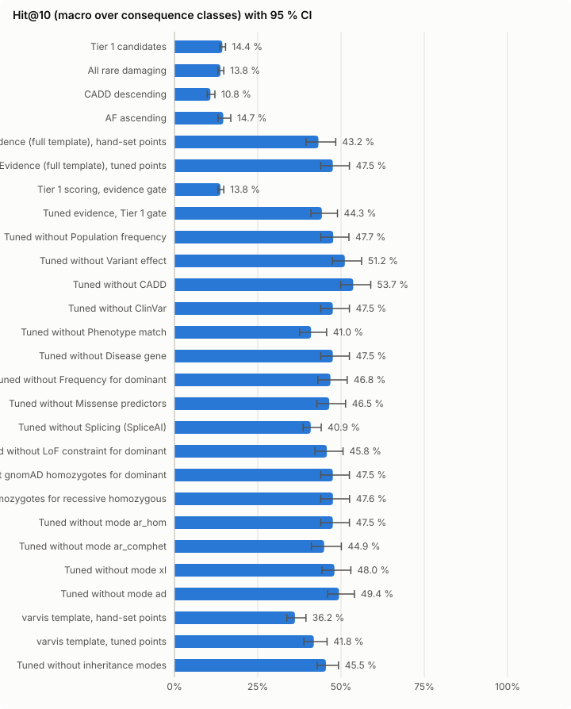
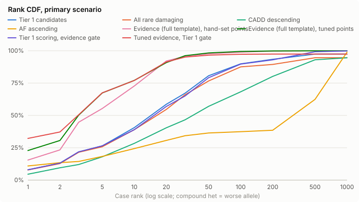

# Evidence shortlist simulation — 2026-10-15-full-template

Created 2026-10-15T17:57:44.424Z. Reference scorer `tier1`, candidate `evidence_tuned`. All numbers are aggregates over simulated cases; no background row is reported.

## Ship verdict

**Verdict: DO NOT SHIP** — at least one pre-registered criterion (spec §11.5) fails; no preset is seeded.

| Criterion | Value | Needs | Result |
| --- | --- | --- | --- |
| Test gene clusters (primary) | 1178 | ≥ 300 | pass |
| Mode strata in the pooled endpoint | 4 | ≥ 1 stratum with ≥ 30 cases | pass |
| Primary: lower 95 % bound of ΔHit@10 | 0.2953 | > +0.03 | pass |
| Primary: upper 95 % bound of Δ decoys in top 10 | 0 | ≤ +0.5 | pass |
| ClinVar visible: lower 95 % bound of ΔHit@10 | -0.2015 | > -0.02 | **FAIL** |
| ClinVar visible: upper 95 % bound of Δ decoys in top 10 | -0.0102 | ≤ +0.5 | pass |
| Annotation acceptance fully evaluated (inputs not provisional) | 1 | = 1 | pass |
| Filter sensitivity: one-sided 97.5 % Clopper–Pearson lower bound (1176/1178 clusters) | 0.9939 | ≥ 0.97 | pass |

Pooled mode strata: AD, AR_HOM, AR_COMPHET, XLD.

- Failed: ClinVar visible: lower 95 % bound of ΔHit@10 = -0.2015 (needs > -0.02)

## Ship verdict — hand-set points (`evidence_hand`, pre-registered)

**Verdict: SHIP** — every pre-registered criterion (spec §11.5) holds; the hand-set preset may be seeded as a non-default beta.

| Criterion | Value | Needs | Result |
| --- | --- | --- | --- |
| Test gene clusters (primary) | 1178 | ≥ 300 | pass |
| Mode strata in the pooled endpoint | 4 | ≥ 1 stratum with ≥ 30 cases | pass |
| Primary: lower 95 % bound of ΔHit@10 | 0.2514 | > +0.03 | pass |
| Primary: upper 95 % bound of Δ decoys in top 10 | 0 | ≤ +0.5 | pass |
| ClinVar visible: lower 95 % bound of ΔHit@10 | 0.0779 | > -0.02 | pass |
| ClinVar visible: upper 95 % bound of Δ decoys in top 10 | -0.0102 | ≤ +0.5 | pass |
| Annotation acceptance fully evaluated (inputs not provisional) | 1 | = 1 | pass |
| Filter sensitivity: one-sided 97.5 % Clopper–Pearson lower bound (1176/1178 clusters) | 0.9939 | ≥ 0.97 | pass |

Pooled mode strata: AD, AR_HOM, AR_COMPHET, XLD.

Decision: the tuned preset fails and the hand-set preset passes — ship the hand-set points.

## Primary endpoint

Primary scenario (ClinVar masked on all rows, pins off), test folds, Hit@k macro-averaged over consequence classes and pooled over AD, AR_HOM, AR_COMPHET, XLD modes. Intervals: 95 % gene-cluster bootstrap. Δ = scorer − reference, paired over the same resampled clusters.

Test gene clusters: 1178.

| Scorer | Cases | Hit@10 [95 % CI] | Hit@1 | Hit@5 | Hit@20 | Hit@50 | Tie-avg Hit@10 | MRR | Tie-avg MRR | Median rank | ΔHit@10 vs reference |
| --- | --- | --- | --- | --- | --- | --- | --- | --- | --- | --- | --- |
| Tier 1 candidates | 3620 | 14.4 % [13.6 %, 15.3 %] | 2.8 % | 9.4 % | 23.4 % | 39.4 % | 14.4 % | 0.072 | 0.071 | 15.0 | reference |
| All rare damaging | 3620 | 13.8 % [13.1 %, 14.8 %] | 2.8 % | 9.1 % | 19.7 % | 36.4 % | 13.8 % | 0.069 | 0.068 | 17.5 | -0.6 [-0.8, -0.4] pts |
| CADD descending | 3620 | 10.8 % [9.8 %, 12.1 %] | 1.6 % | 6.4 % | 17.8 % | 28.8 % | 10.9 % | 0.050 | 0.050 | 36.0 | -3.6 [-4.5, -2.7] pts |
| AF ascending | 3620 | 14.7 % [13.1 %, 16.9 %] | 5.2 % | 9.6 % | 21.4 % | 28.2 % | 1.4 % | 0.082 | 0.010 | 440.0 | +0.3 [-1.3, +2.0] pts |
| Evidence (full template), hand-set points | 3620 | 43.2 % [39.5 %, 48.4 %] | 7.2 % | 29.5 % | 60.2 % | 72.8 % | 45.3 % | 0.182 | 0.188 | 4.0 | +28.8 [+25.1, +34.1] pts |
| Evidence (full template), tuned points | 3620 | 47.5 % [43.9 %, 52.5 %] | 9.4 % | 38.6 % | 59.5 % | 71.1 % | 48.3 % | 0.212 | 0.215 | 3.0 | +33.2 [+29.5, +38.1] pts |
| Tier 1 scoring, evidence gate | 3620 | 13.8 % [13.1 %, 14.8 %] | 2.8 % | 9.4 % | 22.3 % | 38.0 % | 13.8 % | 0.071 | 0.069 | 17.0 | -0.6 [-0.8, -0.4] pts |
| Tuned evidence, Tier 1 gate | 3620 | 44.3 % [41.0 %, 48.9 %] | 13.7 % | 36.7 % | 55.7 % | 61.3 % | 44.8 % | 0.229 | 0.234 | 3.0 | +29.9 [+26.5, +34.7] pts |
| Tuned without Population frequency | 3620 | 47.7 % [44.0 %, 52.4 %] | 8.7 % | 35.1 % | 57.3 % | 66.8 % | 48.2 % | 0.197 | 0.200 | 4.0 | +33.3 [+29.6, +38.0] pts |
| Tuned without Variant effect | 3620 | 51.2 % [47.4 %, 56.2 %] | 14.4 % | 41.6 % | 61.5 % | 75.1 % | 51.6 % | 0.265 | 0.267 | 5.0 | +36.8 [+33.0, +41.7] pts |
| Tuned without CADD | 3620 | 53.7 % [49.9 %, 58.9 %] | 16.0 % | 43.2 % | 63.7 % | 75.8 % | 53.8 % | 0.277 | 0.280 | 3.0 | +39.3 [+35.4, +44.8] pts |
| Tuned without ClinVar | 3620 | 47.5 % [43.9 %, 52.5 %] | 9.4 % | 38.6 % | 59.5 % | 71.1 % | 48.3 % | 0.212 | 0.215 | 3.0 | +33.2 [+29.5, +38.1] pts |
| Tuned without Phenotype match | 3620 | 41.0 % [37.6 %, 45.7 %] | 9.3 % | 31.0 % | 51.8 % | 64.2 % | 41.5 % | 0.188 | 0.190 | 4.0 | +26.6 [+23.2, +31.3] pts |
| Tuned without Disease gene | 3620 | 47.5 % [43.9 %, 52.5 %] | 9.4 % | 38.6 % | 59.5 % | 71.1 % | 48.3 % | 0.212 | 0.215 | 3.0 | +33.2 [+29.5, +38.1] pts |
| Tuned without Frequency for dominant | 3620 | 46.8 % [43.1 %, 51.9 %] | 9.4 % | 37.1 % | 59.0 % | 70.5 % | 47.8 % | 0.207 | 0.210 | 4.0 | +32.4 [+28.7, +37.5] pts |
| Tuned without Missense predictors | 3620 | 46.5 % [42.8 %, 51.4 %] | 7.5 % | 36.3 % | 58.5 % | 69.8 % | 46.9 % | 0.206 | 0.209 | 3.0 | +32.1 [+28.4, +37.0] pts |
| Tuned without Splicing (SpliceAI) | 3620 | 40.9 % [38.6 %, 44.1 %] | 14.4 % | 32.4 % | 57.4 % | 69.3 % | 41.4 % | 0.237 | 0.240 | 3.0 | +26.5 [+24.2, +29.6] pts |
| Tuned without LoF constraint for dominant | 3620 | 45.8 % [42.2 %, 50.6 %] | 9.5 % | 38.0 % | 59.9 % | 71.5 % | 47.2 % | 0.211 | 0.214 | 3.0 | +31.4 [+27.8, +36.3] pts |
| Tuned without gnomAD homozygotes for dominant | 3620 | 47.5 % [43.9 %, 52.5 %] | 9.4 % | 38.6 % | 59.5 % | 71.1 % | 48.3 % | 0.212 | 0.215 | 3.0 | +33.2 [+29.5, +38.1] pts |
| Tuned without gnomAD homozygotes for recessive homozygous | 3620 | 47.6 % [43.9 %, 52.6 %] | 9.4 % | 38.7 % | 59.5 % | 71.1 % | 48.3 % | 0.212 | 0.216 | 3.0 | +33.2 [+29.6, +38.1] pts |
| Tuned without mode ar_hom | 3620 | 47.5 % [43.9 %, 52.5 %] | 9.4 % | 38.6 % | 59.5 % | 71.1 % | 48.3 % | 0.212 | 0.215 | 3.0 | +33.2 [+29.5, +38.1] pts |
| Tuned without mode ar_comphet | 3620 | 44.9 % [41.1 %, 50.1 %] | 2.3 % | 29.2 % | 58.6 % | 67.9 % | 44.9 % | 0.153 | 0.156 | 4.0 | +30.6 [+26.8, +35.8] pts |
| Tuned without mode xl | 3620 | 48.0 % [44.3 %, 53.0 %] | 9.6 % | 39.2 % | 60.2 % | 71.1 % | 48.8 % | 0.215 | 0.218 | 3.0 | +33.6 [+30.0, +38.7] pts |
| Tuned without mode ad | 3620 | 49.4 % [46.0 %, 54.0 %] | 11.6 % | 30.6 % | 61.1 % | 72.9 % | 49.8 % | 0.216 | 0.217 | 4.0 | +35.0 [+31.5, +39.8] pts |
| varvis template, hand-set points | 3620 | 36.2 % [33.7 %, 39.5 %] | 6.9 % | 24.5 % | 49.2 % | 69.8 % | 36.3 % | 0.168 | 0.173 | 4.0 | +21.8 [+19.2, +25.3] pts |
| varvis template, tuned points | 3620 | 41.8 % [38.8 %, 45.8 %] | 10.9 % | 31.8 % | 56.4 % | 68.7 % | 42.6 % | 0.216 | 0.220 | 3.0 | +27.5 [+24.4, +31.5] pts |
| Tuned without inheritance modes | 3620 | 45.5 % [42.9 %, 49.2 %] | 2.9 % | 30.7 % | 61.7 % | 73.1 % | 46.4 % | 0.164 | 0.167 | 4.0 | +31.1 [+28.5, +34.9] pts |

## Strata (Hit@10, primary scenario)

### Per mode

Macro over classes within the mode; all modes shown, including strata dropped from the pooled endpoint.

| Stratum | Cases | Tier 1 candidates | All rare damaging | CADD descending | AF ascending | Evidence (full template), hand-set points | Evidence (full template), tuned points | Tier 1 scoring, evidence gate | Tuned evidence, Tier 1 gate | Tuned without Population frequency | Tuned without Variant effect | Tuned without CADD | Tuned without ClinVar | Tuned without Phenotype match | Tuned without Disease gene | Tuned without Frequency for dominant | Tuned without Missense predictors | Tuned without Splicing (SpliceAI) | Tuned without LoF constraint for dominant | Tuned without gnomAD homozygotes for dominant | Tuned without gnomAD homozygotes for recessive homozygous | Tuned without mode ar_hom | Tuned without mode ar_comphet | Tuned without mode xl | Tuned without mode ad | varvis template, hand-set points | varvis template, tuned points | Tuned without inheritance modes |
| --- | --- | --- | --- | --- | --- | --- | --- | --- | --- | --- | --- | --- | --- | --- | --- | --- | --- | --- | --- | --- | --- | --- | --- | --- | --- | --- | --- | --- |
| AD | 1248 | 17.7 % | 17.3 % | 15.9 % | 27.4 % | 42.4 % | 32.9 % | 17.3 % | 33.0 % | 33.0 % | 38.5 % | 35.1 % | 32.9 % | 28.3 % | 32.9 % | 32.8 % | 29.3 % | 32.3 % | 33.0 % | 32.9 % | 32.9 % | 32.9 % | 28.4 % | 32.9 % | 51.4 % | 30.6 % | 30.0 % | 44.6 % |
| AR_HOM | 1683 | 21.0 % | 20.2 % | 14.6 % | 8.3 % | 64.5 % | 81.9 % | 20.2 % | 75.4 % | 82.6 % | 84.9 % | 89.2 % | 81.9 % | 74.8 % | 81.9 % | 80.8 % | 86.6 % | 70.0 % | 78.5 % | 81.9 % | 82.1 % | 81.9 % | 77.7 % | 81.9 % | 72.7 % | 62.2 % | 76.5 % | 63.7 % |
| AR_COMPHET | 641 | 15.3 % | 13.9 % | 7.7 % | 1.8 % | 46.8 % | 49.1 % | 13.9 % | 50.1 % | 54.8 % | 44.1 % | 69.9 % | 49.1 % | 39.4 % | 49.1 % | 47.8 % | 51.7 % | 44.4 % | 45.2 % | 49.1 % | 49.1 % | 49.1 % | 76.6 % | 49.1 % | 34.1 % | 47.1 % | 45.7 % | 59.2 % |
| XLD | 48 | 25.3 % | 25.3 % | 12.6 % | 38.7 % | 57.7 % | 51.1 % | 25.3 % | 55.0 % | 53.1 % | 54.7 % | 79.4 % | 51.1 % | 44.1 % | 51.1 % | 51.1 % | 42.0 % | 50.0 % | 46.0 % | 51.1 % | 51.1 % | 51.1 % | 44.1 % | 83.3 % | 38.2 % | 51.0 % | 42.0 % | 60.4 % |
| XLR | 0 | – | – | – | – | – | – | – | – | – | – | – | – | – | – | – | – | – | – | – | – | – | – | – | – | – | – | – |

X-linked stratum (XLD + XLR, 48 cases; XLR only in male backgrounds): candidate Hit@10 51.1 % [36.6 %, 80.7 %], Δ vs reference +25.8 [+13.3, +41.7] pts.

### Per consequence class

Plain mean within the class (spec §11.2 class of a case).

| Stratum | Cases | Tier 1 candidates | All rare damaging | CADD descending | AF ascending | Evidence (full template), hand-set points | Evidence (full template), tuned points | Tier 1 scoring, evidence gate | Tuned evidence, Tier 1 gate | Tuned without Population frequency | Tuned without Variant effect | Tuned without CADD | Tuned without ClinVar | Tuned without Phenotype match | Tuned without Disease gene | Tuned without Frequency for dominant | Tuned without Missense predictors | Tuned without Splicing (SpliceAI) | Tuned without LoF constraint for dominant | Tuned without gnomAD homozygotes for dominant | Tuned without gnomAD homozygotes for recessive homozygous | Tuned without mode ar_hom | Tuned without mode ar_comphet | Tuned without mode xl | Tuned without mode ad | varvis template, hand-set points | varvis template, tuned points | Tuned without inheritance modes |
| --- | --- | --- | --- | --- | --- | --- | --- | --- | --- | --- | --- | --- | --- | --- | --- | --- | --- | --- | --- | --- | --- | --- | --- | --- | --- | --- | --- | --- |
| lof | 2553 | 57.5 % | 55.3 % | 39.1 % | 21.7 % | 78.6 % | 83.4 % | 55.3 % | 83.7 % | 84.0 % | 68.5 % | 93.6 % | 83.4 % | 78.9 % | 83.4 % | 83.1 % | 88.7 % | 83.4 % | 82.0 % | 83.4 % | 83.4 % | 83.4 % | 86.5 % | 83.5 % | 80.7 % | 91.3 % | 89.0 % | 83.3 % |
| missense | 979 | 0.0 % | 0.0 % | 2.9 % | 33.3 % | 61.4 % | 64.1 % | 0.0 % | 64.0 % | 65.2 % | 72.7 % | 63.7 % | 64.1 % | 53.4 % | 64.1 % | 63.9 % | 47.2 % | 64.4 % | 63.2 % | 64.1 % | 64.2 % | 64.1 % | 55.5 % | 64.7 % | 79.1 % | 42.4 % | 52.7 % | 76.6 % |
| inframe | 6 | 0.0 % | 0.0 % | 0.0 % | 0.0 % | 0.0 % | 0.0 % | 0.0 % | 0.0 % | 0.0 % | 0.0 % | 0.0 % | 0.0 % | 0.0 % | 0.0 % | 0.0 % | 0.0 % | 0.0 % | 0.0 % | 0.0 % | 0.0 % | 0.0 % | 0.0 % | 0.0 % | 0.0 % | 0.0 % | 0.0 % | 0.0 % |
| other | 82 | 0.0 % | 0.0 % | 1.2 % | 3.7 % | 32.9 % | 42.7 % | 0.0 % | 29.3 % | 41.5 % | 63.4 % | 57.3 % | 42.7 % | 31.7 % | 42.7 % | 40.2 % | 50.0 % | 15.9 % | 37.8 % | 42.7 % | 42.7 % | 42.7 % | 37.8 % | 43.9 % | 37.8 % | 11.0 % | 25.6 % | 22.0 % |

### Per background

Per-background results of the cross-validated (gene-fold) evaluation; backgrounds are not held out. Leave-one-background-out was not performed: the shipped hand-set ruleset has no fitted parameters, so a background hold-out does not apply to it.

| Stratum | Cases | Tier 1 candidates | All rare damaging | CADD descending | AF ascending | Evidence (full template), hand-set points | Evidence (full template), tuned points | Tier 1 scoring, evidence gate | Tuned evidence, Tier 1 gate | Tuned without Population frequency | Tuned without Variant effect | Tuned without CADD | Tuned without ClinVar | Tuned without Phenotype match | Tuned without Disease gene | Tuned without Frequency for dominant | Tuned without Missense predictors | Tuned without Splicing (SpliceAI) | Tuned without LoF constraint for dominant | Tuned without gnomAD homozygotes for dominant | Tuned without gnomAD homozygotes for recessive homozygous | Tuned without mode ar_hom | Tuned without mode ar_comphet | Tuned without mode xl | Tuned without mode ad | varvis template, hand-set points | varvis template, tuned points | Tuned without inheritance modes |
| --- | --- | --- | --- | --- | --- | --- | --- | --- | --- | --- | --- | --- | --- | --- | --- | --- | --- | --- | --- | --- | --- | --- | --- | --- | --- | --- | --- | --- |
| bg1 | 1188 | 13.9 % | 13.9 % | 10.1 % | 15.1 % | 41.4 % | 51.4 % | 13.9 % | 47.5 % | 53.2 % | 53.7 % | 54.6 % | 51.4 % | 38.5 % | 51.4 % | 51.4 % | 47.3 % | 46.3 % | 47.8 % | 51.4 % | 51.4 % | 51.4 % | 51.9 % | 51.5 % | 56.7 % | 41.3 % | 46.2 % | 55.2 % |
| bg2 | 1272 | 14.5 % | 14.4 % | 11.7 % | 10.9 % | 44.0 % | 41.2 % | 14.4 % | 39.6 % | 41.8 % | 46.4 % | 54.6 % | 41.2 % | 38.9 % | 41.2 % | 41.2 % | 43.4 % | 30.7 % | 40.8 % | 41.2 % | 41.3 % | 41.2 % | 42.7 % | 41.6 % | 43.9 % | 32.4 % | 35.9 % | 35.6 % |
| bg3 | 1160 | 14.9 % | 13.0 % | 10.4 % | 18.1 % | 44.6 % | 50.6 % | 13.0 % | 46.2 % | 48.8 % | 53.9 % | 52.3 % | 50.6 % | 45.8 % | 50.6 % | 48.6 % | 48.9 % | 46.0 % | 49.2 % | 50.6 % | 50.6 % | 50.6 % | 41.1 % | 51.4 % | 48.3 % | 35.1 % | 43.8 % | 46.1 % |

### Temporal stratum

P/LP absent or not P/LP in ClinVar 2024-01 vs older.

| Stratum | Cases | Tier 1 candidates | All rare damaging | CADD descending | AF ascending | Evidence (full template), hand-set points | Evidence (full template), tuned points | Tier 1 scoring, evidence gate | Tuned evidence, Tier 1 gate | Tuned without Population frequency | Tuned without Variant effect | Tuned without CADD | Tuned without ClinVar | Tuned without Phenotype match | Tuned without Disease gene | Tuned without Frequency for dominant | Tuned without Missense predictors | Tuned without Splicing (SpliceAI) | Tuned without LoF constraint for dominant | Tuned without gnomAD homozygotes for dominant | Tuned without gnomAD homozygotes for recessive homozygous | Tuned without mode ar_hom | Tuned without mode ar_comphet | Tuned without mode xl | Tuned without mode ad | varvis template, hand-set points | varvis template, tuned points | Tuned without inheritance modes |
| --- | --- | --- | --- | --- | --- | --- | --- | --- | --- | --- | --- | --- | --- | --- | --- | --- | --- | --- | --- | --- | --- | --- | --- | --- | --- | --- | --- | --- |
| new since 2024 | 599 | 16.7 % | 15.8 % | 14.4 % | 17.5 % | 56.5 % | 67.7 % | 15.8 % | 62.9 % | 69.3 % | 66.7 % | 73.8 % | 67.7 % | 59.3 % | 67.7 % | 67.6 % | 67.2 % | 53.2 % | 63.9 % | 67.7 % | 67.7 % | 67.7 % | 67.1 % | 67.7 % | 61.0 % | 50.9 % | 55.7 % | 57.9 % |
| older | 3021 | 14.8 % | 14.3 % | 10.8 % | 14.8 % | 43.4 % | 46.9 % | 14.3 % | 43.6 % | 46.8 % | 51.3 % | 53.3 % | 46.9 % | 40.3 % | 46.9 % | 46.0 % | 45.8 % | 41.1 % | 45.3 % | 46.9 % | 46.9 % | 46.9 % | 43.9 % | 47.4 % | 50.0 % | 35.9 % | 41.9 % | 45.8 % |

## Scenarios (Hit@10, macro)

| Scenario | Cases | Tier 1 candidates | All rare damaging | CADD descending | AF ascending | Evidence (full template), hand-set points | Evidence (full template), tuned points | Tier 1 scoring, evidence gate | Tuned evidence, Tier 1 gate | Tuned without Population frequency | Tuned without Variant effect | Tuned without CADD | Tuned without ClinVar | Tuned without Phenotype match | Tuned without Disease gene | Tuned without Frequency for dominant | Tuned without Missense predictors | Tuned without Splicing (SpliceAI) | Tuned without LoF constraint for dominant | Tuned without gnomAD homozygotes for dominant | Tuned without gnomAD homozygotes for recessive homozygous | Tuned without mode ar_hom | Tuned without mode ar_comphet | Tuned without mode xl | Tuned without mode ad | varvis template, hand-set points | varvis template, tuned points | Tuned without inheritance modes | Δ candidate − reference |
| --- | --- | --- | --- | --- | --- | --- | --- | --- | --- | --- | --- | --- | --- | --- | --- | --- | --- | --- | --- | --- | --- | --- | --- | --- | --- | --- | --- | --- | --- |
| primary | 3620 | 14.4 % | 13.8 % | 10.8 % | 14.7 % | 43.2 % | 47.5 % | 13.8 % | 44.3 % | 47.7 % | 51.2 % | 53.7 % | 47.5 % | 41.0 % | 47.5 % | 46.8 % | 46.5 % | 40.9 % | 45.8 % | 47.5 % | 47.6 % | 47.5 % | 44.9 % | 48.0 % | 49.4 % | 36.2 % | 41.8 % | 45.5 % | +33.2 [+29.5, +38.1] pts |
| clinvar_visible | 3620 | 86.7 % | 13.8 % | 10.8 % | 14.7 % | 98.1 % | 70.2 % | 99.4 % | 60.5 % | – | – | – | – | – | – | – | – | – | – | – | – | – | – | – | – | 97.1 % | 71.2 % | – | -16.5 [-20.2, -11.9] pts |
| pheno_free | 3620 | 14.4 % | 13.8 % | 10.8 % | 14.7 % | 43.6 % | 41.0 % | 13.8 % | 38.1 % | – | – | – | – | – | – | – | – | – | – | – | – | – | – | – | – | 32.7 % | 36.9 % | – | +26.6 [+23.2, +31.3] pts |
| pheno_shuffled | 3620 | 14.4 % | 13.8 % | 10.8 % | 14.7 % | 45.0 % | 33.0 % | 13.8 % | 32.0 % | – | – | – | – | – | – | – | – | – | – | – | – | – | – | – | – | 34.2 % | 27.0 % | – | +18.6 [+15.8, +22.2] pts |
| missingness | 3620 | 14.0 % | 13.5 % | 10.7 % | 15.2 % | 10.6 % | 10.5 % | 13.5 % | 10.4 % | – | – | – | – | – | – | – | – | – | – | – | – | – | – | – | – | 10.2 % | 8.4 % | – | -3.5 [-4.8, -2.2] pts |
| pheno_enriched | 1204 | 19.2 % | 18.5 % | 13.1 % | 19.4 % | 79.8 % | 65.7 % | 18.5 % | 60.1 % | – | – | – | – | – | – | – | – | – | – | – | – | – | – | – | – | 66.3 % | 58.5 % | – | +46.5 [+38.6, +54.6] pts |

## Decoy intrusion

10 rare benign decoys per case; primary scenario.

| Scorer | Mean decoys in top 10 | Cases with ≥ 1 | Δ mean vs reference [95 % CI] |
| --- | --- | --- | --- |
| Tier 1 candidates | 0.01 | 1.4 % | reference |
| All rare damaging | 0.01 | 1.4 % | 0.00 [0.00, 0.00] |
| CADD descending | 0.01 | 1.4 % | 0.00 [0.00, 0.00] |
| AF ascending | 0.00 | 0.0 % | -0.01 [-0.02, -0.01] |
| Evidence (full template), hand-set points | 0.01 | 1.4 % | 0.00 [0.00, 0.00] |
| Evidence (full template), tuned points | 0.01 | 1.4 % | 0.00 [0.00, 0.00] |
| Tier 1 scoring, evidence gate | 0.01 | 1.4 % | 0.00 [0.00, 0.00] |
| Tuned evidence, Tier 1 gate | 0.01 | 1.4 % | 0.00 [0.00, 0.00] |
| Tuned without Population frequency | 0.02 | 2.1 % | +0.01 [+0.00, +0.01] |
| Tuned without Variant effect | 0.01 | 1.0 % | -0.00 [-0.01, -0.00] |
| Tuned without CADD | 0.01 | 1.4 % | 0.00 [0.00, 0.00] |
| Tuned without ClinVar | 0.01 | 1.4 % | 0.00 [0.00, 0.00] |
| Tuned without Phenotype match | 0.02 | 2.3 % | +0.01 [+0.01, +0.01] |
| Tuned without Disease gene | 0.01 | 1.4 % | 0.00 [0.00, 0.00] |
| Tuned without Frequency for dominant | 0.01 | 1.4 % | 0.00 [0.00, 0.00] |
| Tuned without Missense predictors | 0.01 | 1.4 % | 0.00 [0.00, 0.00] |
| Tuned without Splicing (SpliceAI) | 0.01 | 1.4 % | 0.00 [0.00, 0.00] |
| Tuned without LoF constraint for dominant | 0.01 | 1.4 % | 0.00 [0.00, 0.00] |
| Tuned without gnomAD homozygotes for dominant | 0.01 | 1.4 % | 0.00 [0.00, 0.00] |
| Tuned without gnomAD homozygotes for recessive homozygous | 0.01 | 1.4 % | 0.00 [0.00, 0.00] |
| Tuned without mode ar_hom | 0.01 | 1.4 % | 0.00 [0.00, 0.00] |
| Tuned without mode ar_comphet | 0.01 | 1.4 % | 0.00 [0.00, 0.00] |
| Tuned without mode xl | 0.01 | 1.4 % | 0.00 [0.00, 0.00] |
| Tuned without mode ad | 0.01 | 1.2 % | -0.00 [-0.00, -0.00] |
| varvis template, hand-set points | 0.01 | 1.4 % | 0.00 [0.00, 0.00] |
| varvis template, tuned points | 0.01 | 1.4 % | 0.00 [0.00, 0.00] |
| Tuned without inheritance modes | 0.01 | 1.4 % | 0.00 [0.00, 0.00] |

## Filter sensitivity and burden

Allele sensitivity = causal alleles passing the scorer’s gate. Cluster bound: one-sided 97.5 % Clopper–Pearson lower bound, failure = gene cluster with ≥ 1 gated-out causal allele. Burden = median eligible rows per case.

| Scorer | Allele sensitivity | Clusters passing | Cluster lower bound | Median burden |
| --- | --- | --- | --- | --- |
| Tier 1 candidates | 97.8 % | 1134/1178 | 95.0 % | 405 |
| All rare damaging | 95.4 % | 1069/1178 | 88.9 % | 440 |
| CADD descending | 100.0 % | 1176/1178 | 99.4 % | 1947 |
| AF ascending | 100.0 % | 1176/1178 | 99.4 % | 1947 |
| Evidence (full template), hand-set points | 100.0 % | 1176/1178 | 99.4 % | 1947 |
| Evidence (full template), tuned points | 100.0 % | 1176/1178 | 99.4 % | 1947 |
| Tier 1 scoring, evidence gate | 100.0 % | 1176/1178 | 99.4 % | 1947 |
| Tuned evidence, Tier 1 gate | 97.8 % | 1134/1178 | 95.0 % | 405 |
| Tuned without Population frequency | 100.0 % | 1176/1178 | 99.4 % | 1947 |
| Tuned without Variant effect | 100.0 % | 1176/1178 | 99.4 % | 1947 |
| Tuned without CADD | 100.0 % | 1176/1178 | 99.4 % | 1947 |
| Tuned without ClinVar | 100.0 % | 1176/1178 | 99.4 % | 1947 |
| Tuned without Phenotype match | 100.0 % | 1176/1178 | 99.4 % | 1947 |
| Tuned without Disease gene | 100.0 % | 1176/1178 | 99.4 % | 1947 |
| Tuned without Frequency for dominant | 100.0 % | 1176/1178 | 99.4 % | 1947 |
| Tuned without Missense predictors | 100.0 % | 1176/1178 | 99.4 % | 1947 |
| Tuned without Splicing (SpliceAI) | 100.0 % | 1176/1178 | 99.4 % | 1947 |
| Tuned without LoF constraint for dominant | 100.0 % | 1176/1178 | 99.4 % | 1947 |
| Tuned without gnomAD homozygotes for dominant | 100.0 % | 1176/1178 | 99.4 % | 1947 |
| Tuned without gnomAD homozygotes for recessive homozygous | 100.0 % | 1176/1178 | 99.4 % | 1947 |
| Tuned without mode ar_hom | 100.0 % | 1176/1178 | 99.4 % | 1947 |
| Tuned without mode ar_comphet | 100.0 % | 1176/1178 | 99.4 % | 1947 |
| Tuned without mode xl | 100.0 % | 1176/1178 | 99.4 % | 1947 |
| Tuned without mode ad | 100.0 % | 1176/1178 | 99.4 % | 1947 |
| varvis template, hand-set points | 100.0 % | 1176/1178 | 99.4 % | 1947 |
| varvis template, tuned points | 100.0 % | 1176/1178 | 99.4 % | 1947 |
| Tuned without inheritance modes | 100.0 % | 1176/1178 | 99.4 % | 1947 |

## Tuned points (refit on all folds)

Spec §14–15 (amend §11.1): points = log2 enrichment (pseudo-count ½) relative to the group’s anchor — the bin with the most training positives (0 points) — rounded to 0.5, clipped ±8; a group is a complete partition, so the anchor choice does not change any ranking. A bin with a + b < 10 gets 0; a bin with fewer than 5 positives can only score at or below the anchor; a group with fewer than 20 training positives gets 0 throughout. ClinVar is tuned only as P/LP vs the pooled other ClinVar bins (spikes are all P/LP, so the other bins are not identifiable); those keep their template points as non-tuned priors. Positives A = 4259, background rows B = 5692 (primary scenario). Intervals: 95 % gene-cluster bootstrap of the unrounded points, relative to the same anchor.

Protocol note: §14 (anchor) and §15 (most-positive anchor, no bonus for bins with < 5 positives, ClinVar priors) amended the §11.1 estimator after a smoke run (bg1, provisional mapping) and the quick run (bg1, 50 cases) exposed estimator artefacts — all-zero groups under the reference-bin support rule, then positive points for bins without positives. The amendments target the estimator, not observed performance; `evidence_hand` (fully pre-registered points) is reported next to `evidence_tuned` as the pre-registered comparator, and the ship rule is evaluated for both.

| Group | Bin | a | b | Points | Bootstrap interval |
| --- | --- | --- | --- | --- | --- |
| modes | ar_hom (anchor) | 1677 | 16 | 0.0 | [0.00, 0.00] |
| modes | ar_comphet | 1406 | 273 | -4.5 | [-5.70, -3.34] |
| modes | xl | 48 | 13 | -5.0 | [-6.50, -3.41] |
| modes | ad | 1112 | 732 | -6.0 | [-7.46, -5.16] |
| modes | fallback (catch-all) | 16 | 4658 | -8.0 | [-16.81, -13.60] |
| freq | af_missing (anchor) | 1508 | 1126 | 0.0 | [0.00, 0.00] |
| freq | af_lt_1e5 | 993 | 294 | +1.5 | [+1.01, +1.65] |
| freq | af_lt_1e4 | 1329 | 508 | +1.0 | [+0.68, +1.26] |
| freq | af_lt_1e3 | 390 | 993 | -2.0 | [-2.15, -1.40] |
| freq | af_ref (catch-all) | 39 | 2771 | -6.5 | [-7.42, -5.93] |
| effect | lof (anchor) | 2968 | 144 | 0.0 | [0.00, 0.00] |
| effect | missense | 1161 | 1240 | -4.5 | [-4.79, -4.14] |
| effect | inframe | 6 | 138 | -8.0 | [-11.07, -7.63] |
| effect | splice_region | 60 | 227 | -6.5 | [-7.23, -5.52] |
| effect | mnv | 12 | 313 | -8.0 | [-13.67, -7.68] |
| effect | effect_ref (catch-all) | 52 | 3630 | -8.0 | [-11.32, -9.83] |
| cadd | cadd_30 (anchor) | 2234 | 92 | 0.0 | [0.00, 0.00] |
| cadd | cadd_25 | 826 | 205 | -2.5 | [-3.02, -2.16] |
| cadd | cadd_20 | 686 | 481 | -4.0 | [-4.48, -3.70] |
| cadd | cadd_15 | 189 | 482 | -6.0 | [-6.47, -5.48] |
| cadd | cadd_ref (catch-all) | 324 | 4432 | -8.0 | [-8.79, -7.95] |
| clinvar | clinvar_plp_2star | 4259 | 10 | +8.0 | [+21.40, +23.33] |
| clinvar | clinvar_plp | 0 | 2 | +5.0 (prior, not tuned) | – |
| clinvar | clinvar_conflict | 0 | 180 | +1.0 (prior, not tuned) | – |
| clinvar | clinvar_vus | 0 | 337 | +1.0 (prior, not tuned) | – |
| clinvar | clinvar_blb | 0 | 823 | -4.0 (prior, not tuned) | – |
| clinvar | clinvar_ref (catch-all) | 0 | 4340 | 0.0 (prior, not tuned) | – |
| phenotype | hpo_15 | 427 | 228 | 0.0 | [-0.67, +0.16] |
| phenotype | hpo_10 | 909 | 352 | 0.0 | [-0.07, +0.51] |
| phenotype | hpo_05 | 1139 | 491 | 0.0 | [-0.21, +0.33] |
| phenotype | hpo_gt0 (anchor) | 1775 | 799 | 0.0 | [0.00, 0.00] |
| phenotype | hpo_ref (catch-all) | 9 | 3822 | -8.0 | [-11.50, -8.90] |
| gene | omim_gene (anchor) | 4259 | 4902 | 0.0 | [0.00, 0.00] |
| gene | gene_ref (catch-all) | 0 | 790 | -8.0 | [-10.62, -10.21] |
| ad_freq | ad_af_high | 0 | 507 | -8.0 | [-12.62, -11.98] |
| ad_freq | ad_af_ref (catch-all) (anchor) | 1112 | 225 | 0.0 | [0.00, 0.00] |
| missense_pred | revel_high | 693 | 48 | +4.5 | [+3.91, +4.90] |
| missense_pred | revel_mid | 253 | 94 | +2.0 | [+1.54, +2.40] |
| missense_pred | revel_low | 48 | 841 | -3.5 | [-4.61, -2.82] |
| missense_pred | metarnn_high | 35 | 0 | +6.5 | [+5.42, +7.53] |
| missense_pred | missense_pred_ref (catch-all) (anchor) | 3230 | 4709 | 0.0 | [0.00, 0.00] |
| splicing | spliceai_high | 787 | 46 | +5.0 | [+4.39, +5.37] |
| splicing | spliceai_mid | 211 | 87 | +2.0 | [+1.52, +2.50] |
| splicing | splicing_ref (catch-all) (anchor) | 3261 | 5559 | 0.0 | [0.00, 0.00] |
| constraint | loeuf_strong (anchor) | 510 | 200 | 0.0 | [0.00, 0.00] |
| constraint | loeuf_mod | 278 | 159 | -0.5 | [-0.98, -0.12] |
| constraint | constraint_ref (catch-all) | 324 | 373 | -1.5 | [-1.95, -1.13] |
| hom_ad | ad_hom_seen | 0 | 62 | -7.5 | [-8.10, -7.23] |
| hom_ad | hom_ad_ref (catch-all) (anchor) | 1112 | 670 | 0.0 | [0.00, 0.00] |
| hom_ar | ar_hom_seen | 17 | 0 | -1.5 | [-3.04, -0.42] |
| hom_ar | hom_ar_ref (catch-all) (anchor) | 1660 | 16 | 0.0 | [0.00, 0.00] |

## Ablations

ΔHit@10 = ablation − tuned evidence scorer, primary scenario, paired gene-cluster bootstrap.

| Ablation | ΔHit@10 [95 % CI] |
| --- | --- |
| Tuned without Population frequency | +0.1 [-1.7, +2.0] pts |
| Tuned without Variant effect | +3.6 [+1.0, +6.5] pts |
| Tuned without CADD | +6.1 [+3.6, +8.8] pts |
| Tuned without ClinVar | 0.0 [0.0, 0.0] pts |
| Tuned without Phenotype match | -6.5 [-8.7, -4.9] pts |
| Tuned without Disease gene | 0.0 [0.0, 0.0] pts |
| Tuned without Frequency for dominant | -0.7 [-1.7, -0.1] pts |
| Tuned without Missense predictors | -1.1 [-3.0, +0.7] pts |
| Tuned without Splicing (SpliceAI) | -6.6 [-9.7, -4.0] pts |
| Tuned without LoF constraint for dominant | -1.8 [-3.1, -0.7] pts |
| Tuned without gnomAD homozygotes for dominant | 0.0 [0.0, 0.0] pts |
| Tuned without gnomAD homozygotes for recessive homozygous | +0.0 [0.0, +0.1] pts |
| Tuned without mode ar_hom | 0.0 [0.0, 0.0] pts |
| Tuned without mode ar_comphet | -2.6 [-4.3, -1.4] pts |
| Tuned without mode xl | +0.5 [+0.1, +1.3] pts |
| Tuned without mode ad | +1.9 [-1.0, +4.6] pts |
| Tuned without inheritance modes | -2.1 [-5.3, +0.7] pts |

## Pool selection funnel

| Step | Remaining |
| --- | --- |
| pool: records | 4428918 |
| pool: benign_clnsig | 1360242 |
| pool: benign_drop_review | 1073211 |
| pool: benign_eligible | 253937 |
| pool: plp_clnsig | 338445 |
| pool: plp_drop_review | 244142 |
| pool: benign_drop_gene | 30583 |
| pool: plp_eligible | 57553 |
| pool: plp_drop_size | 3423 |
| pool: plp_drop_gene | 10147 |
| pool: benign_drop_size | 2253 |
| pool: plp_drop_disease | 1884 |
| pool: plp_drop_moi_ambiguous | 9931 |
| pool: plp_drop_origin | 1470 |
| pool: plp_drop_moi_none | 9895 |
| pool: benign_drop_origin | 258 |
| pool: plp_eligible_genes | 2620 |
| pool: benign_eligible_genes | 8916 |
| pool: plp_after_gene_cap | 6405 |
| pool: plp_sampled_AD | 1300 |
| pool: plp_sampled_AR | 1800 |
| pool: plp_sampled_XLD | 91 |
| pool: plp_sampled_XLR | 236 |
| pool: benign_after_gene_cap | 15826 |
| pool: benign_sampled | 2000 |
| pool: plp_sampled_new_since_2024 | 509 |
| cases: causal_in_background_genes | 3142 |
| cases: causal_freq_implausible | 26 |
| cases: causal_xlr_not_simulated | 137 |
| cases: cases_AD | 1248 |
| cases: cases_AR_HOM | 1683 |
| cases: cases_AR_COMPHET | 641 |
| cases: cases_XLD | 48 |
| cases: cases_XLR | 0 |

## Annotation concordance (spec §11.4)

| Field | Metric | Value | Tolerance | Decision |
| --- | --- | --- | --- | --- |
| gnomad_af (exome_popmax), backgrounds | median |Δlog10| | 0.023 | ≤ 0.1 | accepted |
| gnomad_af (exome_popmax), pool | median |Δlog10| | 0.000 | ≤ 0.1 | accepted |
| cadd, backgrounds | median |Δ| | 0.000 | ≤ 0.5 | accepted |
| cadd, backgrounds | Pearson | 1.000 | ≥ 0.98 | accepted |
| cadd, pool | median |Δ| | 0.000 | ≤ 0.5 | accepted |
| cadd, pool | Pearson | 1.000 | ≥ 0.98 | accepted |

Pool excluded for an unmapped `func` term: 0.1 %.

## Provenance

Bootstrap replicates: 2000.

| Seed | Value |
| --- | --- |
| cases | 20261012 |
| folds | 20261013 |
| bootstrap | 20261014 |
| scenario | 20261015 |
| quick | 20261016 |

| Input | SHA-256 |
| --- | --- |
| pool | `7c837f71fb90ae222088b14406c24d4d54575f82ef5f4a581f264b5e3f21b85e` |
| annotations | `27b74823b69b385c028ca8c638e7d75b0c46e89dbf42f8aedc802535c930cd27` |
| concordance | `9da45fdaa41105e9b0b81ba37dbe885372dcd2e44cbb9fa769905ec18ef0d1dc` |
| caddApiValues | `36b86b9ec66a2b85006df84e20e986aacabf3d429ae0e00cf2e91271a91a8924` |
| template | `e53a37dc9eecf61a896ce1d45472a3a35329014bd3d181ad0315092ec8e1809a` |
| background:bg1 | `d13ef4a8c0115613f8fbb1ae4ca79178d6bc9f366060bf552396a26c2c4eb4a4` |
| background:bg2 | `afdd197f77286b8b7f45743f8014385b5a10620beb865b11c4a5854e142d716b` |
| background:bg3 | `521c6b22688090313874481307ef5d36bad7a69aa2efe7f60cc00045c93871b5` |

## Full template vs varvis template (paired)

Same cases, same folds; `evidence_*` use the full template, `varvis_*` the 18-field varvis template. Hit@10 macro over classes, all modes; Δ = full − varvis, paired gene-cluster bootstrap.

| Scenario | Pair | Full Hit@10 | varvis Hit@10 | Δ |
| --- | --- | --- | --- | --- |
| primary | evidence_hand vs varvis_hand | 43.2 % [39.5 %, 48.4 %] | 36.2 % [33.7 %, 39.5 %] | +7.1 [+3.9, +10.7] pts |
| primary | evidence_tuned vs varvis_tuned | 47.5 % [43.9 %, 52.5 %] | 41.8 % [38.8 %, 45.8 %] | +5.7 [+3.1, +8.9] pts |
| clinvar_visible | evidence_hand vs varvis_hand | 98.1 % [96.3 %, 99.4 %] | 97.1 % [95.2 %, 98.8 %] | +1.0 [-0.4, +2.5] pts |
| clinvar_visible | evidence_tuned vs varvis_tuned | 70.2 % [67.3 %, 73.1 %] | 71.2 % [68.4 %, 74.0 %] | -1.0 [-2.7, +0.7] pts |

## Sensitivity: macro over classes with ≥ 30 test cases

The pre-registered primary endpoint averages over all consequence classes; a class with very few cases then carries the same weight as a large one, and its absence from a bootstrap resample shifts the macro (skewed intervals). Here classes with fewer than 30 test cases are dropped, as mode strata are. Kept: other, lof, missense; dropped: inframe (6). The ship decision uses the primary endpoint, not this one.

| Scorer | Cases | Hit@10 [95 % CI] | ΔHit@10 vs tier1 |
| --- | --- | --- | --- |
| tier1 | 3614 | 19.2 % [18.1 %, 20.2 %] | reference |
| all_rare_damaging | 3614 | 18.4 % [17.4 %, 19.5 %] | -0.8 [-1.0, -0.5] pts |
| cadd_desc | 3614 | 14.4 % [13.1 %, 15.9 %] | -4.8 [-5.9, -3.5] pts |
| af_asc | 3614 | 19.5 % [17.4 %, 21.8 %] | +0.4 [-2.0, +2.7] pts |
| evidence_hand | 3614 | 57.6 % [52.8 %, 62.7 %] | +38.5 [+33.7, +43.4] pts |
| evidence_tuned | 3614 | 63.4 % [58.5 %, 68.6 %] | +44.2 [+39.4, +49.5] pts |

## CADD fidelity check

Spike CADD: SNVs from the CADD v1.7 API; indels (and SNVs without a precomputed score) imputed from background rows with the same varvis func and allele class, missing values included. Spike rows by CADD source: cadd-api 38585, local-vep 0, imputed 1874, none 2. Threat: imputed CADD is not the variant’s own score, and the varvis CADD version is unknown (see the concordance checks).

Primary scenario, SNV-only cases (every causal allele has its real CADD), all modes:

| Scorer | Cases | Hit@10 [95 % CI] |
| --- | --- | --- |
| tier1 | 2601 | 28.2 % [27.3 %, 29.0 %] |
| cadd_desc | 2601 | 22.2 % [20.6 %, 24.0 %] |
| evidence_tuned | 2601 | 70.8 % [65.3 %, 76.3 %] |

ΔHit@10 evidence_tuned − tier1 on SNV-only cases: +42.6 [+37.0, +48.3] pts.
