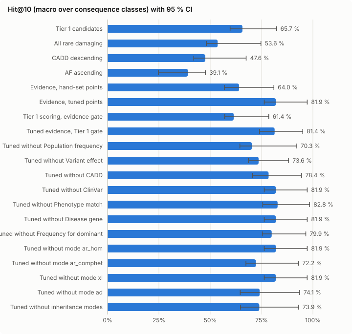
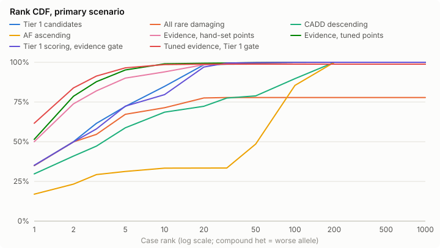

# Evidence shortlist simulation — 2026-10-15-xlr-male-backgrounds

Created 2026-10-15T17:36:07.632Z. Reference scorer `tier1`, candidate `evidence_tuned`. All numbers are aggregates over simulated cases; no background row is reported.

## Ship verdict

**Verdict: SHIP** — every pre-registered criterion (spec §11.5) holds; the tuned preset may be seeded as a non-default beta.

| Criterion | Value | Needs | Result |
| --- | --- | --- | --- |
| Test gene clusters (primary) | 422 | ≥ 300 | pass |
| Mode strata in the pooled endpoint | 5 | ≥ 1 stratum with ≥ 30 cases | pass |
| Primary: lower 95 % bound of ΔHit@10 | 0.1036 | > +0.03 | pass |
| Primary: upper 95 % bound of Δ decoys in top 10 | 0.4714 | ≤ +0.5 | pass |
| ClinVar visible: lower 95 % bound of ΔHit@10 | 0.0283 | > -0.02 | pass |
| ClinVar visible: upper 95 % bound of Δ decoys in top 10 | -0.0619 | ≤ +0.5 | pass |
| Annotation acceptance fully evaluated (inputs not provisional) | 1 | = 1 | pass |
| Filter sensitivity: one-sided 97.5 % Clopper–Pearson lower bound (422/422 clusters) | 0.9913 | ≥ 0.97 | pass |

Pooled mode strata: AD, AR_HOM, AR_COMPHET, XLD, XLR.

## Ship verdict — hand-set points (`evidence_hand`, pre-registered)

**Verdict: DO NOT SHIP** — at least one pre-registered criterion (spec §11.5) fails; no preset is seeded.

| Criterion | Value | Needs | Result |
| --- | --- | --- | --- |
| Test gene clusters (primary) | 422 | ≥ 300 | pass |
| Mode strata in the pooled endpoint | 5 | ≥ 1 stratum with ≥ 30 cases | pass |
| Primary: lower 95 % bound of ΔHit@10 | -0.0807 | > +0.03 | **FAIL** |
| Primary: upper 95 % bound of Δ decoys in top 10 | -0.0059 | ≤ +0.5 | pass |
| ClinVar visible: lower 95 % bound of ΔHit@10 | 0.0283 | > -0.02 | pass |
| ClinVar visible: upper 95 % bound of Δ decoys in top 10 | -0.1354 | ≤ +0.5 | pass |
| Annotation acceptance fully evaluated (inputs not provisional) | 1 | = 1 | pass |
| Filter sensitivity: one-sided 97.5 % Clopper–Pearson lower bound (422/422 clusters) | 0.9913 | ≥ 0.97 | pass |

Pooled mode strata: AD, AR_HOM, AR_COMPHET, XLD, XLR.

- Failed: Primary: lower 95 % bound of ΔHit@10 = -0.0807 (needs > +0.03)

Decision: ship the tuned preset.

## Primary endpoint

Primary scenario (ClinVar masked on all rows, pins off), test folds, Hit@k macro-averaged over consequence classes and pooled over AD, AR_HOM, AR_COMPHET, XLD, XLR modes. Intervals: 95 % gene-cluster bootstrap. Δ = scorer − reference, paired over the same resampled clusters.

Test gene clusters: 422.

| Scorer | Cases | Hit@10 [95 % CI] | Hit@1 | Hit@5 | Hit@20 | Hit@50 | Tie-avg Hit@10 | MRR | Tie-avg MRR | Median rank | ΔHit@10 vs reference |
| --- | --- | --- | --- | --- | --- | --- | --- | --- | --- | --- | --- |
| Tier 1 candidates | 3648 | 65.7 % [59.7 %, 82.3 %] | 15.5 % | 42.8 % | 85.1 % | 91.5 % | 65.7 % | 0.289 | 0.288 | 2.0 | reference |
| All rare damaging | 3648 | 53.6 % [48.1 %, 74.7 %] | 15.5 % | 41.1 % | 63.2 % | 67.2 % | 53.8 % | 0.261 | 0.261 | 3.0 | -12.1 [-20.1, -6.2] pts |
| CADD descending | 3648 | 47.6 % [42.0 %, 67.5 %] | 13.7 % | 34.1 % | 63.1 % | 84.7 % | 47.6 % | 0.240 | 0.240 | 4.0 | -18.1 [-30.5, -7.8] pts |
| AF ascending | 3648 | 39.1 % [24.8 %, 47.7 %] | 10.3 % | 32.9 % | 42.2 % | 56.7 % | 8.9 % | 0.199 | 0.047 | 52.0 | -26.6 [-50.0, -15.0] pts |
| Evidence, hand-set points | 3648 | 64.0 % [56.9 %, 81.0 %] | 23.7 % | 54.5 % | 79.1 % | 94.2 % | 63.4 % | 0.386 | 0.371 | 1.0 | -1.7 [-8.1, +7.9] pts |
| Evidence, tuned points | 3648 | 81.9 % [76.3 %, 97.2 %] | 24.2 % | 59.8 % | 84.8 % | 92.6 % | 80.2 % | 0.416 | 0.416 | 1.0 | +16.3 [+10.4, +22.2] pts |
| Tier 1 scoring, evidence gate | 3648 | 61.4 % [57.1 %, 78.5 %] | 15.5 % | 42.8 % | 80.2 % | 97.7 % | 60.6 % | 0.283 | 0.283 | 3.0 | -4.3 [-10.3, -0.9] pts |
| Tuned evidence, Tier 1 gate | 3648 | 81.4 % [74.0 %, 95.1 %] | 32.2 % | 65.9 % | 89.9 % | 91.5 % | 79.2 % | 0.470 | 0.468 | 1.0 | +15.7 [+7.1, +20.4] pts |
| Tuned without Population frequency | 3648 | 70.3 % [64.4 %, 92.1 %] | 24.7 % | 55.0 % | 78.5 % | 84.8 % | 68.9 % | 0.389 | 0.391 | 1.0 | +4.6 [-0.7, +14.6] pts |
| Tuned without Variant effect | 3648 | 73.6 % [68.7 %, 88.2 %] | 21.2 % | 62.8 % | 79.2 % | 91.9 % | 71.4 % | 0.393 | 0.395 | 2.0 | +7.9 [+0.1, +13.8] pts |
| Tuned without CADD | 3648 | 78.4 % [70.7 %, 94.4 %] | 22.0 % | 61.6 % | 81.6 % | 91.5 % | 74.5 % | 0.398 | 0.390 | 1.0 | +12.8 [+4.6, +22.1] pts |
| Tuned without ClinVar | 3648 | 81.9 % [76.3 %, 97.2 %] | 24.2 % | 59.8 % | 84.8 % | 92.6 % | 80.2 % | 0.416 | 0.416 | 1.0 | +16.3 [+10.4, +22.2] pts |
| Tuned without Phenotype match | 3648 | 82.8 % [75.6 %, 98.4 %] | 23.9 % | 59.7 % | 84.4 % | 92.6 % | 80.5 % | 0.416 | 0.415 | 1.0 | +17.1 [+10.1, +26.5] pts |
| Tuned without Disease gene | 3648 | 81.9 % [76.3 %, 97.2 %] | 24.2 % | 59.8 % | 84.8 % | 92.6 % | 80.2 % | 0.416 | 0.416 | 1.0 | +16.3 [+10.4, +22.2] pts |
| Tuned without Frequency for dominant | 3648 | 79.9 % [75.4 %, 96.6 %] | 22.8 % | 57.9 % | 84.8 % | 86.4 % | 77.7 % | 0.392 | 0.392 | 2.0 | +14.3 [+7.2, +20.5] pts |
| Tuned without mode ar_hom | 3648 | 81.9 % [76.3 %, 97.2 %] | 24.2 % | 59.8 % | 84.8 % | 92.6 % | 80.2 % | 0.416 | 0.416 | 1.0 | +16.3 [+10.4, +22.2] pts |
| Tuned without mode ar_comphet | 3648 | 72.2 % [67.4 %, 92.9 %] | 19.3 % | 58.5 % | 84.4 % | 92.3 % | 72.0 % | 0.373 | 0.370 | 2.0 | +6.5 [-1.4, +14.5] pts |
| Tuned without mode xl | 3648 | 81.9 % [76.3 %, 97.2 %] | 24.5 % | 60.3 % | 85.5 % | 93.8 % | 80.2 % | 0.418 | 0.417 | 1.0 | +16.2 [+10.4, +22.2] pts |
| Tuned without mode ad | 3648 | 74.1 % [64.6 %, 93.5 %] | 25.0 % | 63.1 % | 89.9 % | 98.9 % | 74.0 % | 0.424 | 0.422 | 1.0 | +8.4 [-7.5, +17.1] pts |
| Tuned without inheritance modes | 3648 | 73.9 % [64.7 %, 93.1 %] | 20.2 % | 58.9 % | 85.2 % | 99.3 % | 72.8 % | 0.386 | 0.382 | 2.0 | +8.2 [-7.5, +16.8] pts |

## Strata (Hit@10, primary scenario)

### Per mode

Macro over classes within the mode; all modes shown, including strata dropped from the pooled endpoint.

| Stratum | Cases | Tier 1 candidates | All rare damaging | CADD descending | AF ascending | Evidence, hand-set points | Evidence, tuned points | Tier 1 scoring, evidence gate | Tuned evidence, Tier 1 gate | Tuned without Population frequency | Tuned without Variant effect | Tuned without CADD | Tuned without ClinVar | Tuned without Phenotype match | Tuned without Disease gene | Tuned without Frequency for dominant | Tuned without mode ar_hom | Tuned without mode ar_comphet | Tuned without mode xl | Tuned without mode ad | Tuned without inheritance modes |
| --- | --- | --- | --- | --- | --- | --- | --- | --- | --- | --- | --- | --- | --- | --- | --- | --- | --- | --- | --- | --- | --- |
| AD | 1061 | 59.3 % | 50.0 % | 59.6 % | 69.9 % | 51.9 % | 76.2 % | 61.7 % | 67.0 % | 63.0 % | 65.2 % | 59.4 % | 76.2 % | 76.3 % | 76.2 % | 76.1 % | 76.2 % | 64.4 % | 76.1 % | 83.1 % | 83.2 % |
| AR_HOM | 1748 | 74.5 % | 56.0 % | 48.3 % | 11.7 % | 81.0 % | 92.7 % | 64.7 % | 94.0 % | 83.1 % | 84.2 % | 99.1 % | 92.7 % | 97.8 % | 92.7 % | 86.4 % | 92.7 % | 79.0 % | 92.7 % | 70.6 % | 69.3 % |
| AR_COMPHET | 643 | 79.0 % | 63.4 % | 53.2 % | 1.1 % | 76.7 % | 99.3 % | 68.2 % | 99.5 % | 90.3 % | 86.6 % | 99.3 % | 99.3 % | 99.3 % | 99.3 % | 99.2 % | 99.3 % | 99.3 % | 99.3 % | 98.3 % | 99.3 % |
| XLD | 89 | 74.9 % | 70.6 % | 61.8 % | 81.3 % | 75.0 % | 79.2 % | 73.0 % | 79.2 % | 75.0 % | 68.8 % | 70.8 % | 79.2 % | 79.2 % | 79.2 % | 75.0 % | 79.2 % | 70.8 % | 79.2 % | 66.7 % | 70.8 % |
| XLR | 107 | 95.2 % | 87.9 % | 45.3 % | 88.2 % | 92.7 % | 99.4 % | 92.0 % | 99.4 % | 99.3 % | 46.1 % | 66.7 % | 99.4 % | 99.4 % | 99.4 % | 99.4 % | 99.4 % | 81.4 % | 100.0 % | 63.4 % | 66.1 % |

X-linked stratum (XLD + XLR, 196 cases; XLR only in male backgrounds): candidate Hit@10 83.1 % [66.3 %, 100.0 %], Δ vs reference +4.3 [+1.7, +7.4] pts.

### Per consequence class

Plain mean within the class (spec §11.2 class of a case).

| Stratum | Cases | Tier 1 candidates | All rare damaging | CADD descending | AF ascending | Evidence, hand-set points | Evidence, tuned points | Tier 1 scoring, evidence gate | Tuned evidence, Tier 1 gate | Tuned without Population frequency | Tuned without Variant effect | Tuned without CADD | Tuned without ClinVar | Tuned without Phenotype match | Tuned without Disease gene | Tuned without Frequency for dominant | Tuned without mode ar_hom | Tuned without mode ar_comphet | Tuned without mode xl | Tuned without mode ad | Tuned without inheritance modes |
| --- | --- | --- | --- | --- | --- | --- | --- | --- | --- | --- | --- | --- | --- | --- | --- | --- | --- | --- | --- | --- | --- |
| lof | 2682 | 81.6 % | 63.9 % | 62.6 % | 26.8 % | 97.2 % | 99.6 % | 75.0 % | 99.4 % | 99.2 % | 83.3 % | 99.7 % | 99.6 % | 99.6 % | 99.6 % | 99.6 % | 99.6 % | 99.7 % | 99.7 % | 99.2 % | 99.7 % |
| missense | 883 | 98.0 % | 96.8 % | 90.4 % | 53.0 % | 89.1 % | 99.3 % | 96.7 % | 99.4 % | 97.7 % | 92.9 % | 92.4 % | 99.3 % | 99.5 % | 99.3 % | 99.1 % | 99.3 % | 97.4 % | 99.2 % | 99.0 % | 99.3 % |
| inframe | 16 | 25.0 % | 0.0 % | 0.0 % | 43.8 % | 25.0 % | 43.8 % | 18.8 % | 62.5 % | 12.5 % | 37.5 % | 50.0 % | 43.8 % | 50.0 % | 43.8 % | 37.5 % | 43.8 % | 18.8 % | 43.8 % | 25.0 % | 25.0 % |
| other | 67 | 58.2 % | 53.7 % | 37.3 % | 32.8 % | 44.8 % | 85.1 % | 55.2 % | 64.2 % | 71.6 % | 80.6 % | 71.6 % | 85.1 % | 82.1 % | 85.1 % | 83.6 % | 85.1 % | 73.1 % | 85.1 % | 73.1 % | 71.6 % |

### Per background

Per-background results of the cross-validated (gene-fold) evaluation; backgrounds are not held out. Leave-one-background-out was not performed: the shipped hand-set ruleset has no fitted parameters, so a background hold-out does not apply to it.

| Stratum | Cases | Tier 1 candidates | All rare damaging | CADD descending | AF ascending | Evidence, hand-set points | Evidence, tuned points | Tier 1 scoring, evidence gate | Tuned evidence, Tier 1 gate | Tuned without Population frequency | Tuned without Variant effect | Tuned without CADD | Tuned without ClinVar | Tuned without Phenotype match | Tuned without Disease gene | Tuned without Frequency for dominant | Tuned without mode ar_hom | Tuned without mode ar_comphet | Tuned without mode xl | Tuned without mode ad | Tuned without inheritance modes |
| --- | --- | --- | --- | --- | --- | --- | --- | --- | --- | --- | --- | --- | --- | --- | --- | --- | --- | --- | --- | --- | --- |
| bg1 | 751 | 86.9 % | 50.7 % | 46.4 % | 25.6 % | 77.4 % | 94.4 % | 48.3 % | 89.0 % | 58.8 % | 90.1 % | 89.8 % | 94.4 % | 94.4 % | 94.4 % | 69.1 % | 94.4 % | 66.6 % | 94.3 % | 67.5 % | 65.8 % |
| bg2 | 747 | 63.3 % | 55.1 % | 44.4 % | 34.8 % | 57.3 % | 81.4 % | 63.4 % | 74.1 % | 71.0 % | 73.7 % | 74.8 % | 81.4 % | 79.7 % | 81.4 % | 81.4 % | 81.4 % | 71.2 % | 81.4 % | 72.1 % | 70.5 % |
| bg3 | 690 | 46.4 % | 51.1 % | 45.9 % | 24.5 % | 48.0 % | 82.9 % | 46.6 % | 80.3 % | 62.5 % | 74.9 % | 76.0 % | 82.9 % | 82.9 % | 82.9 % | 82.9 % | 82.9 % | 64.9 % | 82.9 % | 76.1 % | 76.6 % |
| bg4 | 732 | 78.3 % | 55.5 % | 51.0 % | 51.5 % | 74.6 % | 77.7 % | 76.2 % | 77.7 % | 77.9 % | 68.1 % | 79.6 % | 77.7 % | 82.3 % | 77.7 % | 76.0 % | 77.7 % | 70.9 % | 77.7 % | 72.7 % | 74.6 % |
| bg5 | 728 | 66.2 % | 55.0 % | 49.4 % | 49.6 % | 74.5 % | 83.0 % | 68.6 % | 91.4 % | 76.9 % | 72.3 % | 79.9 % | 83.0 % | 83.1 % | 83.0 % | 83.0 % | 83.0 % | 83.0 % | 83.0 % | 79.0 % | 79.0 % |

### Temporal stratum

P/LP absent or not P/LP in ClinVar 2024-01 vs older.

| Stratum | Cases | Tier 1 candidates | All rare damaging | CADD descending | AF ascending | Evidence, hand-set points | Evidence, tuned points | Tier 1 scoring, evidence gate | Tuned evidence, Tier 1 gate | Tuned without Population frequency | Tuned without Variant effect | Tuned without CADD | Tuned without ClinVar | Tuned without Phenotype match | Tuned without Disease gene | Tuned without Frequency for dominant | Tuned without mode ar_hom | Tuned without mode ar_comphet | Tuned without mode xl | Tuned without mode ad | Tuned without inheritance modes |
| --- | --- | --- | --- | --- | --- | --- | --- | --- | --- | --- | --- | --- | --- | --- | --- | --- | --- | --- | --- | --- | --- |
| new since 2024 | 588 | 78.9 % | 65.5 % | 54.0 % | 34.3 % | 74.5 % | 94.0 % | 70.9 % | 91.7 % | 86.3 % | 83.9 % | 92.8 % | 94.0 % | 94.0 % | 94.0 % | 94.0 % | 94.0 % | 93.6 % | 94.0 % | 88.7 % | 86.9 % |
| older | 3060 | 65.4 % | 55.4 % | 51.0 % | 40.1 % | 64.2 % | 82.4 % | 62.8 % | 79.4 % | 71.7 % | 73.6 % | 76.4 % | 82.4 % | 82.8 % | 82.4 % | 80.2 % | 82.4 % | 70.6 % | 82.4 % | 75.0 % | 75.8 % |

## Scenarios (Hit@10, macro)

| Scenario | Cases | Tier 1 candidates | All rare damaging | CADD descending | AF ascending | Evidence, hand-set points | Evidence, tuned points | Tier 1 scoring, evidence gate | Tuned evidence, Tier 1 gate | Tuned without Population frequency | Tuned without Variant effect | Tuned without CADD | Tuned without ClinVar | Tuned without Phenotype match | Tuned without Disease gene | Tuned without Frequency for dominant | Tuned without mode ar_hom | Tuned without mode ar_comphet | Tuned without mode xl | Tuned without mode ad | Tuned without inheritance modes | Δ candidate − reference |
| --- | --- | --- | --- | --- | --- | --- | --- | --- | --- | --- | --- | --- | --- | --- | --- | --- | --- | --- | --- | --- | --- | --- |
| primary | 3648 | 65.7 % | 53.6 % | 47.6 % | 39.1 % | 64.0 % | 81.9 % | 61.4 % | 81.4 % | 70.3 % | 73.6 % | 78.4 % | 81.9 % | 82.8 % | 81.9 % | 79.9 % | 81.9 % | 72.2 % | 81.9 % | 74.1 % | 73.9 % | +16.3 [+10.4, +22.2] pts |
| clinvar_visible | 3648 | 91.5 % | 53.6 % | 47.6 % | 39.1 % | 100.0 % | 100.0 % | 100.0 % | 91.5 % | – | – | – | – | – | – | – | – | – | – | – | – | +8.5 [+2.8, +16.4] pts |
| pheno_free | 3648 | 65.7 % | 53.6 % | 47.6 % | 39.1 % | 85.3 % | 82.8 % | 61.4 % | 81.4 % | – | – | – | – | – | – | – | – | – | – | – | – | +17.1 [+10.1, +26.5] pts |
| pheno_shuffled | 3648 | 65.7 % | 53.6 % | 47.6 % | 39.1 % | 72.3 % | 80.5 % | 61.4 % | 82.0 % | – | – | – | – | – | – | – | – | – | – | – | – | +14.8 [+8.7, +20.9] pts |
| missingness | 3648 | 65.3 % | 53.2 % | 47.6 % | 40.7 % | 60.9 % | 76.4 % | 61.1 % | 77.2 % | – | – | – | – | – | – | – | – | – | – | – | – | +11.1 [+5.5, +17.8] pts |
| pheno_enriched | 392 | 83.9 % | 76.8 % | 50.2 % | 48.9 % | 100.0 % | 100.0 % | 80.9 % | 91.7 % | – | – | – | – | – | – | – | – | – | – | – | – | +16.1 [+5.7, +42.0] pts |

## Decoy intrusion

10 rare benign decoys per case; primary scenario.

| Scorer | Mean decoys in top 10 | Cases with ≥ 1 | Δ mean vs reference [95 % CI] |
| --- | --- | --- | --- |
| Tier 1 candidates | 0.19 | 18.4 % | reference |
| All rare damaging | 0.12 | 11.9 % | -0.07 [-0.08, -0.06] |
| CADD descending | 0.40 | 35.5 % | +0.21 [+0.19, +0.23] |
| AF ascending | 0.33 | 23.7 % | +0.15 [+0.13, +0.17] |
| Evidence, hand-set points | 0.17 | 16.6 % | -0.01 [-0.02, -0.01] |
| Evidence, tuned points | 0.64 | 51.6 % | +0.45 [+0.43, +0.47] |
| Tier 1 scoring, evidence gate | 0.15 | 14.6 % | -0.04 [-0.05, -0.03] |
| Tuned evidence, Tier 1 gate | 0.34 | 32.3 % | +0.16 [+0.14, +0.17] |
| Tuned without Population frequency | 0.34 | 30.1 % | +0.15 [+0.13, +0.16] |
| Tuned without Variant effect | 0.95 | 66.5 % | +0.76 [+0.72, +0.80] |
| Tuned without CADD | 0.84 | 62.0 % | +0.66 [+0.62, +0.69] |
| Tuned without ClinVar | 0.64 | 51.6 % | +0.45 [+0.43, +0.47] |
| Tuned without Phenotype match | 0.63 | 51.0 % | +0.44 [+0.41, +0.46] |
| Tuned without Disease gene | 0.64 | 51.6 % | +0.45 [+0.43, +0.47] |
| Tuned without Frequency for dominant | 0.47 | 41.3 % | +0.28 [+0.26, +0.30] |
| Tuned without mode ar_hom | 0.64 | 51.6 % | +0.45 [+0.43, +0.47] |
| Tuned without mode ar_comphet | 0.60 | 50.1 % | +0.41 [+0.39, +0.43] |
| Tuned without mode xl | 0.65 | 50.8 % | +0.46 [+0.43, +0.48] |
| Tuned without mode ad | 0.97 | 68.6 % | +0.79 [+0.76, +0.81] |
| Tuned without inheritance modes | 0.91 | 66.8 % | +0.72 [+0.69, +0.75] |

## Filter sensitivity and burden

Allele sensitivity = causal alleles passing the scorer’s gate. Cluster bound: one-sided 97.5 % Clopper–Pearson lower bound, failure = gene cluster with ≥ 1 gated-out causal allele. Burden = median eligible rows per case.

| Scorer | Allele sensitivity | Clusters passing | Cluster lower bound | Median burden |
| --- | --- | --- | --- | --- |
| Tier 1 candidates | 99.0 % | 412/422 | 95.7 % | 25 |
| All rare damaging | 80.4 % | 283/422 | 62.4 % | 28 |
| CADD descending | 100.0 % | 422/422 | 99.1 % | 171 |
| AF ascending | 100.0 % | 422/422 | 99.1 % | 171 |
| Evidence, hand-set points | 100.0 % | 422/422 | 99.1 % | 171 |
| Evidence, tuned points | 100.0 % | 422/422 | 99.1 % | 171 |
| Tier 1 scoring, evidence gate | 100.0 % | 422/422 | 99.1 % | 171 |
| Tuned evidence, Tier 1 gate | 99.0 % | 412/422 | 95.7 % | 25 |
| Tuned without Population frequency | 100.0 % | 422/422 | 99.1 % | 171 |
| Tuned without Variant effect | 100.0 % | 422/422 | 99.1 % | 171 |
| Tuned without CADD | 100.0 % | 422/422 | 99.1 % | 171 |
| Tuned without ClinVar | 100.0 % | 422/422 | 99.1 % | 171 |
| Tuned without Phenotype match | 100.0 % | 422/422 | 99.1 % | 171 |
| Tuned without Disease gene | 100.0 % | 422/422 | 99.1 % | 171 |
| Tuned without Frequency for dominant | 100.0 % | 422/422 | 99.1 % | 171 |
| Tuned without mode ar_hom | 100.0 % | 422/422 | 99.1 % | 171 |
| Tuned without mode ar_comphet | 100.0 % | 422/422 | 99.1 % | 171 |
| Tuned without mode xl | 100.0 % | 422/422 | 99.1 % | 171 |
| Tuned without mode ad | 100.0 % | 422/422 | 99.1 % | 171 |
| Tuned without inheritance modes | 100.0 % | 422/422 | 99.1 % | 171 |

## Tuned points (refit on all folds)

Spec §14–15 (amend §11.1): points = log2 enrichment (pseudo-count ½) relative to the group’s anchor — the bin with the most training positives (0 points) — rounded to 0.5, clipped ±8; a group is a complete partition, so the anchor choice does not change any ranking. A bin with a + b < 10 gets 0; a bin with fewer than 5 positives can only score at or below the anchor; a group with fewer than 20 training positives gets 0 throughout. ClinVar is tuned only as P/LP vs the pooled other ClinVar bins (spikes are all P/LP, so the other bins are not identifiable); those keep their template points as non-tuned priors. Positives A = 4291, background rows B = 764 (primary scenario). Intervals: 95 % gene-cluster bootstrap of the unrounded points, relative to the same anchor.

Protocol note: §14 (anchor) and §15 (most-positive anchor, no bonus for bins with < 5 positives, ClinVar priors) amended the §11.1 estimator after a smoke run (bg1, provisional mapping) and the quick run (bg1, 50 cases) exposed estimator artefacts — all-zero groups under the reference-bin support rule, then positive points for bins without positives. The amendments target the estimator, not observed performance; `evidence_hand` (fully pre-registered points) is reported next to `evidence_tuned` as the pre-registered comparator, and the ship rule is evaluated for both.

| Group | Bin | a | b | Points | Bootstrap interval |
| --- | --- | --- | --- | --- | --- |
| modes | ar_hom (anchor) | 1748 | 73 | 0.0 | [0.00, 0.00] |
| modes | ar_comphet | 1364 | 177 | -1.5 | [-2.46, -0.95] |
| modes | xl | 196 | 21 | -1.5 | [-2.44, -0.25] |
| modes | ad | 983 | 241 | -2.5 | [-3.39, -1.88] |
| modes | fallback (catch-all) | 0 | 252 | -8.0 | [-14.33, -12.94] |
| freq | af_missing (anchor) | 1484 | 344 | 0.0 | [0.00, 0.00] |
| freq | af_lt_1e5 | 922 | 17 | +3.5 | [+2.82, +4.50] |
| freq | af_lt_1e4 | 1458 | 51 | +2.5 | [+2.15, +3.34] |
| freq | af_lt_1e3 | 411 | 80 | 0.0 | [-0.51, +0.93] |
| freq | af_ref (catch-all) | 16 | 272 | -6.0 | [-9.59, -4.96] |
| effect | lof (anchor) | 3132 | 10 | 0.0 | [0.00, 0.00] |
| effect | missense | 1048 | 100 | -5.0 | [-6.06, -3.99] |
| effect | inframe | 20 | 13 | -7.5 | [-13.54, -5.63] |
| effect | splice_region | 65 | 19 | -6.5 | [-8.27, -5.20] |
| effect | mnv | 0 | 40 | -8.0 | [-15.97, -13.27] |
| effect | effect_ref (catch-all) | 26 | 582 | -8.0 | [-14.83, -11.44] |
| cadd | cadd_30 (anchor) | 2311 | 9 | 0.0 | [0.00, 0.00] |
| cadd | cadd_25 | 688 | 23 | -3.0 | [-4.32, -2.03] |
| cadd | cadd_20 | 189 | 40 | -5.5 | [-7.09, -4.65] |
| cadd | cadd_15 | 80 | 42 | -7.0 | [-8.73, -5.64] |
| cadd | cadd_ref (catch-all) | 1023 | 650 | -7.5 | [-8.43, -6.50] |
| clinvar | clinvar_plp | 4291 | 3 | +8.0 | [+19.78, +23.56] |
| clinvar | clinvar_conflict | 0 | 74 | +1.0 (prior, not tuned) | – |
| clinvar | clinvar_vus | 0 | 85 | +1.0 (prior, not tuned) | – |
| clinvar | clinvar_blb | 0 | 203 | -4.0 (prior, not tuned) | – |
| clinvar | clinvar_ref (catch-all) | 0 | 399 | 0.0 (prior, not tuned) | – |
| phenotype | hpo_15 (anchor) | 1489 | 252 | 0.0 | [0.00, 0.00] |
| phenotype | hpo_10 | 678 | 114 | 0.0 | [-0.49, +0.55] |
| phenotype | hpo_05 | 897 | 181 | -0.5 | [-0.76, +0.28] |
| phenotype | hpo_gt0 | 1227 | 204 | 0.0 | [-0.49, +0.54] |
| phenotype | hpo_ref (catch-all) | 0 | 13 | -7.5 | [-8.20, -6.78] |
| gene | omim_gene (anchor) | 4291 | 764 | 0.0 | [0.00, 0.00] |
| gene | gene_ref (catch-all) | 0 | 0 | 0 (unsupported) | – |
| ad_freq | ad_af_high | 0 | 145 | -8.0 | [-12.07, -11.02] |
| ad_freq | ad_af_ref (catch-all) (anchor) | 983 | 96 | 0.0 | [0.00, 0.00] |

## Ablations

ΔHit@10 = ablation − tuned evidence scorer, primary scenario, paired gene-cluster bootstrap.

| Ablation | ΔHit@10 [95 % CI] |
| --- | --- |
| Tuned without Population frequency | -11.7 [-14.3, -3.8] pts |
| Tuned without Variant effect | -8.4 [-14.7, -5.5] pts |
| Tuned without CADD | -3.5 [-10.4, +3.7] pts |
| Tuned without ClinVar | 0.0 [0.0, 0.0] pts |
| Tuned without Phenotype match | +0.9 [-2.3, +6.3] pts |
| Tuned without Disease gene | 0.0 [0.0, 0.0] pts |
| Tuned without Frequency for dominant | -2.0 [-7.2, -0.0] pts |
| Tuned without mode ar_hom | 0.0 [0.0, 0.0] pts |
| Tuned without mode ar_comphet | -9.7 [-17.7, -3.1] pts |
| Tuned without mode xl | -0.0 [-0.1, +0.0] pts |
| Tuned without mode ad | -7.9 [-24.8, -0.2] pts |
| Tuned without inheritance modes | -8.0 [-24.7, -0.2] pts |

## Pool selection funnel

| Step | Remaining |
| --- | --- |
| pool: records | 4428918 |
| pool: benign_clnsig | 1360242 |
| pool: benign_drop_review | 1073211 |
| pool: benign_eligible | 253937 |
| pool: plp_clnsig | 338445 |
| pool: plp_drop_review | 244142 |
| pool: benign_drop_gene | 30583 |
| pool: plp_eligible | 57553 |
| pool: plp_drop_size | 3423 |
| pool: plp_drop_gene | 10147 |
| pool: benign_drop_size | 2253 |
| pool: plp_drop_disease | 1884 |
| pool: plp_drop_moi_ambiguous | 9931 |
| pool: plp_drop_origin | 1470 |
| pool: plp_drop_moi_none | 9895 |
| pool: benign_drop_origin | 258 |
| pool: plp_eligible_genes | 2620 |
| pool: benign_eligible_genes | 8916 |
| pool: plp_after_gene_cap | 6405 |
| pool: plp_sampled_AD | 1300 |
| pool: plp_sampled_AR | 1800 |
| pool: plp_sampled_XLD | 91 |
| pool: plp_sampled_XLR | 236 |
| pool: benign_after_gene_cap | 15826 |
| pool: benign_sampled | 2000 |
| pool: plp_sampled_new_since_2024 | 509 |
| cases: causal_in_background_genes | 3055 |
| cases: causal_freq_implausible | 20 |
| cases: causal_xlr_not_simulated | 30 |
| cases: cases_AD | 1061 |
| cases: cases_AR_HOM | 1748 |
| cases: cases_AR_COMPHET | 643 |
| cases: cases_XLD | 89 |
| cases: cases_XLR | 107 |

## Annotation concordance (spec §11.4)

| Field | Metric | Value | Tolerance | Decision |
| --- | --- | --- | --- | --- |
| gnomad_af (exome_popmax), backgrounds | median |Δlog10| | 0.023 | ≤ 0.1 | accepted |
| gnomad_af (exome_popmax), pool | median |Δlog10| | 0.000 | ≤ 0.1 | accepted |
| cadd, backgrounds | median |Δ| | 0.000 | ≤ 0.5 | accepted |
| cadd, backgrounds | Pearson | 1.000 | ≥ 0.98 | accepted |
| cadd, pool | median |Δ| | 0.000 | ≤ 0.5 | accepted |
| cadd, pool | Pearson | 1.000 | ≥ 0.98 | accepted |

Pool excluded for an unmapped `func` term: 0.1 %.

## Provenance

Bootstrap replicates: 2000.

| Seed | Value |
| --- | --- |
| cases | 20261012 |
| folds | 20261013 |
| bootstrap | 20261014 |
| scenario | 20261015 |
| quick | 20261016 |

| Input | SHA-256 |
| --- | --- |
| pool | `7c837f71fb90ae222088b14406c24d4d54575f82ef5f4a581f264b5e3f21b85e` |
| annotations | `27b74823b69b385c028ca8c638e7d75b0c46e89dbf42f8aedc802535c930cd27` |
| concordance | `9da45fdaa41105e9b0b81ba37dbe885372dcd2e44cbb9fa769905ec18ef0d1dc` |
| caddApiValues | `36b86b9ec66a2b85006df84e20e986aacabf3d429ae0e00cf2e91271a91a8924` |
| template | `c27e4af2ff7ab2cd8e0361fcd3253390b8415edc34a8274c5549c69621d8f38c` |
| background:bg1 | `8cc60c9876cc146ee05de165261ce3bacb49ba74bb6b544b8c521ec21b1476ac` |
| background:bg2 | `80c896cea11c3218871935cd648ba6751ea5a079dab1b6418086cded622cf2e3` |
| background:bg3 | `7db2704fd92d86d42c04573bb7ccf97fce22c159deb0adc9c8f9a6a890003a9d` |
| background:bg4 | `4a405b5325fbc386af825960a9ebd3381ca4d51cd8f637b8f330d3a842d2294f` |
| background:bg5 | `7f28217e2efd6726c94b379d8b93ddafb4469a33dfad60ec211c69dd947cc5e0` |

## Sensitivity: macro over classes with ≥ 30 test cases

The pre-registered primary endpoint averages over all consequence classes; a class with very few cases then carries the same weight as a large one, and its absence from a bootstrap resample shifts the macro (skewed intervals). Here classes with fewer than 30 test cases are dropped, as mode strata are. Kept: lof, missense, other; dropped: inframe (16). The ship decision uses the primary endpoint, not this one.

| Scorer | Cases | Hit@10 [95 % CI] | ΔHit@10 vs tier1 |
| --- | --- | --- | --- |
| tier1 | 3632 | 79.3 % [72.2 %, 86.2 %] | reference |
| all_rare_damaging | 3632 | 71.5 % [63.6 %, 79.5 %] | -7.8 [-11.4, -4.8] pts |
| cadd_desc | 3632 | 63.4 % [55.2 %, 71.9 %] | -15.8 [-25.7, -4.3] pts |
| af_asc | 3632 | 37.6 % [29.8 %, 46.7 %] | -41.7 [-52.1, -29.5] pts |
| evidence_hand | 3632 | 77.0 % [71.1 %, 83.8 %] | -2.2 [-9.0, +5.8] pts |
| evidence_tuned | 3632 | 94.7 % [88.6 %, 99.7 %] | +15.4 [+8.5, +22.3] pts |

## CADD fidelity check

Spike CADD: SNVs from the CADD v1.7 API; indels (and SNVs without a precomputed score) imputed from background rows with the same varvis func and allele class, missing values included. Spike rows by CADD source: cadd-api 39235, local-vep 0, imputed 1339, none 197. Threat: imputed CADD is not the variant’s own score, and the varvis CADD version is unknown (see the concordance checks).

Primary scenario, SNV-only cases (every causal allele has its real CADD), all modes:

| Scorer | Cases | Hit@10 [95 % CI] |
| --- | --- | --- |
| tier1 | 2659 | 86.6 % [79.5 %, 92.6 %] |
| cadd_desc | 2659 | 76.1 % [67.5 %, 85.1 %] |
| evidence_tuned | 2659 | 97.0 % [92.4 %, 99.9 %] |

ΔHit@10 evidence_tuned − tier1 on SNV-only cases: +10.4 [+3.2, +17.6] pts.
